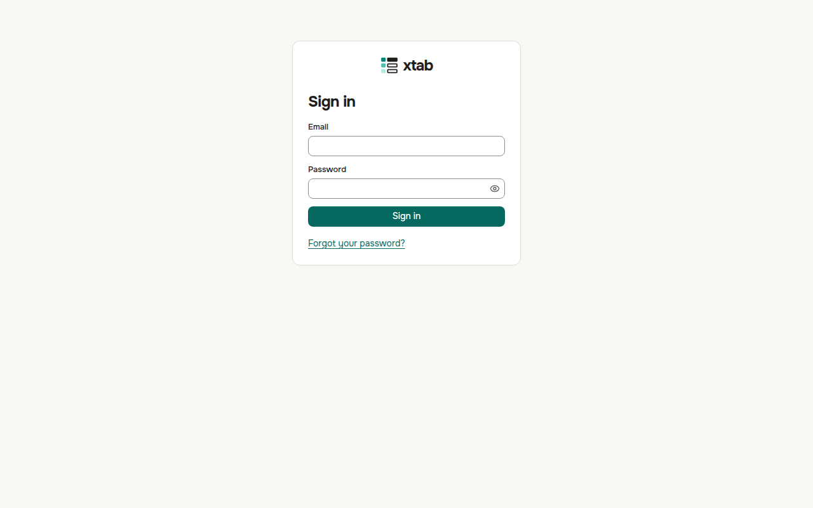

Your first letter from xtab is an invitation with a link. Open the link, enter your name, make up a password of at least 12 characters and click **Join**. The link works once.

Next time, open the address of xtab, enter your e-mail and password and click **Sign in**. To check that you typed the password correctly, click the eye icon on the right of the password field — the password becomes visible; click it again to hide it.

If you forgot your password, click **Forgot your password?**, enter your e-mail and click **Send a link**. Set a new password by the link in the letter.

To sign out, click the circle with your initials in the top right corner and choose **Sign out**.
