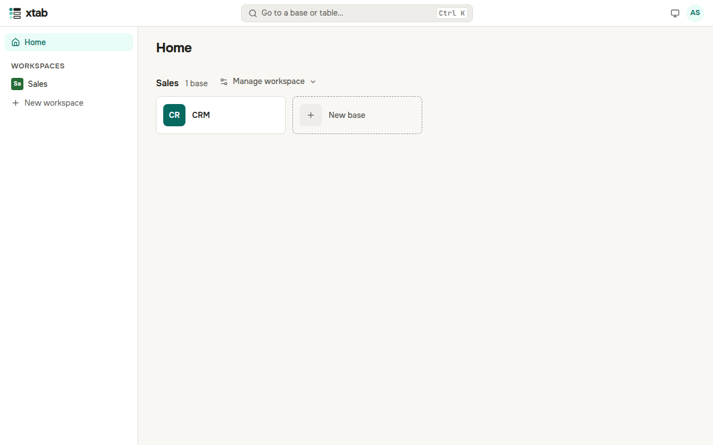

After you sign in, the home page opens. On the left are the workspaces: each gathers the bases of one department or line of work. On the right are the bases of each workspace as tiles. On a phone the list of workspaces stands under the tiles of the bases.

- **New workspace:** on the left, click **New workspace**, enter a name and press Enter.
- **New base:** in the workspace you need, click the tile **New base**, enter a name and press Enter. The base opens right away.
- **Open a base:** click its tile.
- **Go to a workspace:** click it in the list on the left.
- **Copy a workspace** (for the owner of the workspace): click **Manage workspace** next to its name and choose **Copy workspace**, change the name if you like and click **Copy**. The copy gets all the bases of the workspace with their data; you own it, the members of the source do not move to the copy.
- **Rename or delete a workspace** (for its owner): **Manage workspace** → **Rename the workspace** — a new name and **Save**; **Delete the workspace** — with all its bases; xtab asks to confirm.
- The menu **Manage workspace** shows only what you may do: **Access** — for a creator and an owner of the workspace, the rest — for its owner. A reader, a commenter and an editor see the button **Members** instead of the menu.
