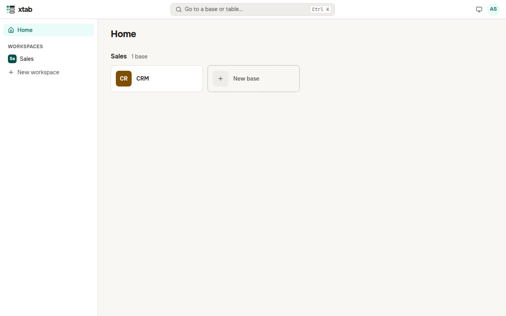

After you sign in, the home page opens. On the left are the workspaces: each gathers the bases of one department or line of work. On the right are the bases of each workspace as tiles.

- **New workspace:** on the left, click **New workspace**, enter a name and press Enter.
- **New base:** in the workspace you need, click the tile **New base**, enter a name and press Enter. The base opens right away.
- **Open a base:** click its tile.
- **Go to a workspace:** click it in the list on the left.
