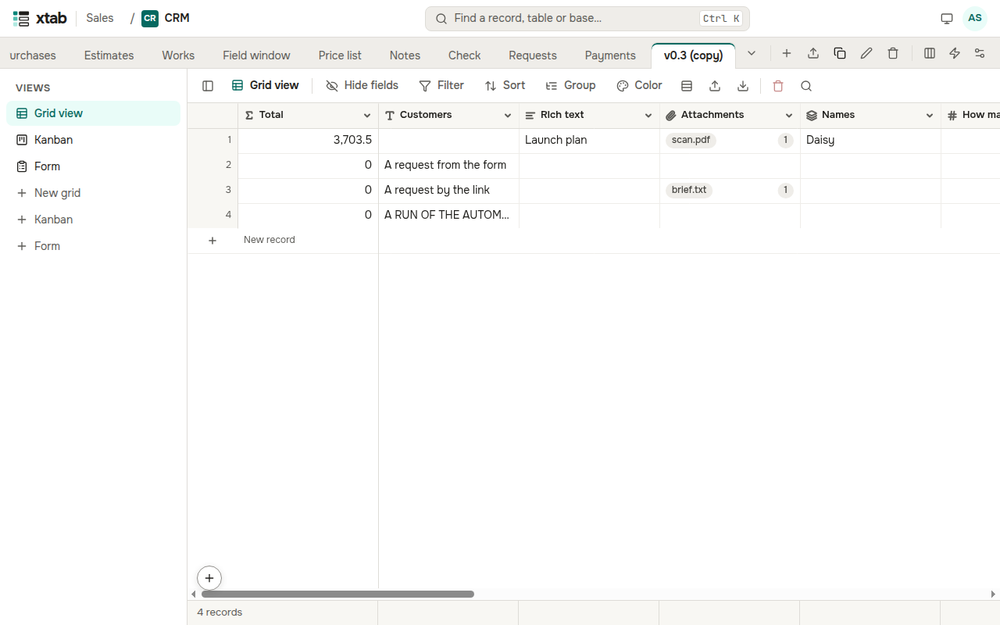

The tables of a base are the tabs under the top bar. The table you opened last in this base opens, or, if it is gone, the first table whose tab you did not hide.

A long name on a tab ends with an ellipsis; the whole of it shows in the tooltip. When the tabs do not fit, only their row scrolls — with the mouse wheel, a swipe or the Tab key: the buttons right after the tabs and **Interfaces**, **Automations** and **Manage base** at the right end stay in place. When the row of tabs has no room for the names of its buttons — a narrower window, a larger zoom or text — every button of the row, **+ Table** and **From a file** too, shows only its icon, with its name in the tooltip; the row stays one line. On a phone the tabs take the first line and the buttons the second one.

- **New table:** click **+ Table** to the right of the tabs, enter a name and press Enter. A new table already has the field «Name».
- **A table from a CSV or Excel file:** click **From a file** to the right of the tabs — see «Import from CSV and Excel».
- **Another table:** click its tab.
- **The order of the tabs:** drag a tab to its new place — a line shows where it lands. From the keyboard: go to the tab with Tab and press Alt+← or Alt+→. The order is the same for every member of the base and changes for them at once; **All tables** lists the tables in it too. The creator and the owner of the base may change it. A new table and a copy go to the end.
- **All tables:** when there are many tables, click the arrow **All tables** right after the tabs. It lists every table of the base with a search by name: a click or Enter opens a table.
- **Hide a tab for yourself:** in **All tables**, click the eye next to a table. The tab disappears for you alone — the others see it as before. The table stays in **All tables**, marked «hidden», and in the quick switcher Ctrl+K, and its tab shows while it is open. The same eye brings the tab back. Hiding changes only how the row of tabs looks and does not limit access to the table.
- **Copy a table:** open the table and click the copy icon to the right of **From a file**, change the name if you like and click **Copy**. The copy shows up as a new tab with the same fields, records, files and shared views. If the table links to another one, that one gets an inverse field named after the copy.
- **Copy a base:** at the end of the row of tabs, click **Manage base** and choose **Copy base**. The copy opens right away with all its tables, the links between them, views and automations. The automations of the copy are turned off and have no secrets: turn them on and set the secrets again when you are ready.
- **Rename or delete a table:** open it and click the pencil or the bin next to the copy icon. Deleting removes the table with all its records; xtab asks to confirm.
- **Rename or delete a base:** **Manage base** → **Rename the base** or **Delete the base**. A deleted base goes with its tables, interfaces and automations, and you return to the home page.
- The menu **Manage base** shows only what you may do: **Access** and **Rename the base** — for a creator and an owner of the base, **Copy base** — for one who may also create bases in its workspace, **Delete the base** — for an owner only. A reader, a commenter and an editor see the button **Members** instead of the menu.

A copy holds the data of the moment you clicked **Copy**: changes made while it is being copied do not get into it. A large base takes a few minutes; the button shows «Copying…». Public links of forms and personal views are not copied.

The top bar shows which workspace and base you are in. Long names are cut — the name of the workspace first — and show in full in the tooltip; on a phone only the base stays in the bar. To go back home, click the xtab logo on the left.
