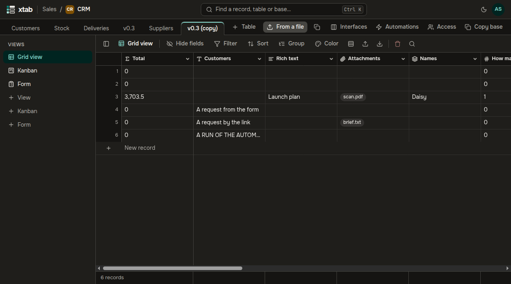

The tables of a base are the tabs under the top bar. The first table opens.

- **New table:** click **+ Table** to the right of the tabs, enter a name and press Enter. A new table already has the field «Name».
- **A table from a CSV or Excel file:** click **From a file** to the right of the tabs — see «Import from CSV and Excel».
- **Another table:** click its tab.
- **Copy a table:** open the table and click the copy icon to the right of **From a file**, change the name if you like and click **Copy**. The copy shows up as a new tab with the same fields, records, files and shared views. If the table links to another one, that one gets an inverse field named after the copy.
- **Copy a base:** click **Copy base** at the end of the row of tabs. The copy opens right away with all its tables, the links between them, views and automations. The automations of the copy are turned off and have no secrets: turn them on and set the secrets again when you are ready.

A copy holds the data of the moment you clicked **Copy**: changes made while it is being copied do not get into it. A large base takes a few minutes; the button shows «Copying…». Public links of forms and personal views are not copied.

The top bar shows which workspace and base you are in. To go back home, click the xtab logo on the left.
