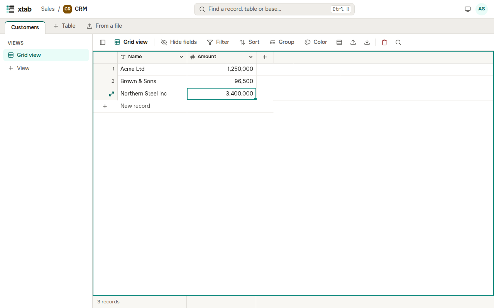

A table shows records as rows and fields as columns. The first column is the primary field of a record: it stays in place when the table scrolls to the right. The number of records in the view is shown at the bottom.

- **Select a cell:** click it. Move between cells with the arrows, Tab, Page Up and Page Down, Home and End.
- **Change a value:** press Enter or double-click the cell, or just start typing. Enter or Tab save the value, Esc cancels the edit. Numbers can be typed with commas: `1,250,000.50`.
- **Checkbox:** press Enter or click the selected cell again.
- **Clear a cell:** press Delete.
- **New record:** click the row **New record** under the last record.
- **New record below the selected one:** press Shift+Enter.
- **Delete a record:** select any of its cells, click the bin above the table and confirm.

Fields the system fills (created time, created by, autonumber) cannot be changed.
