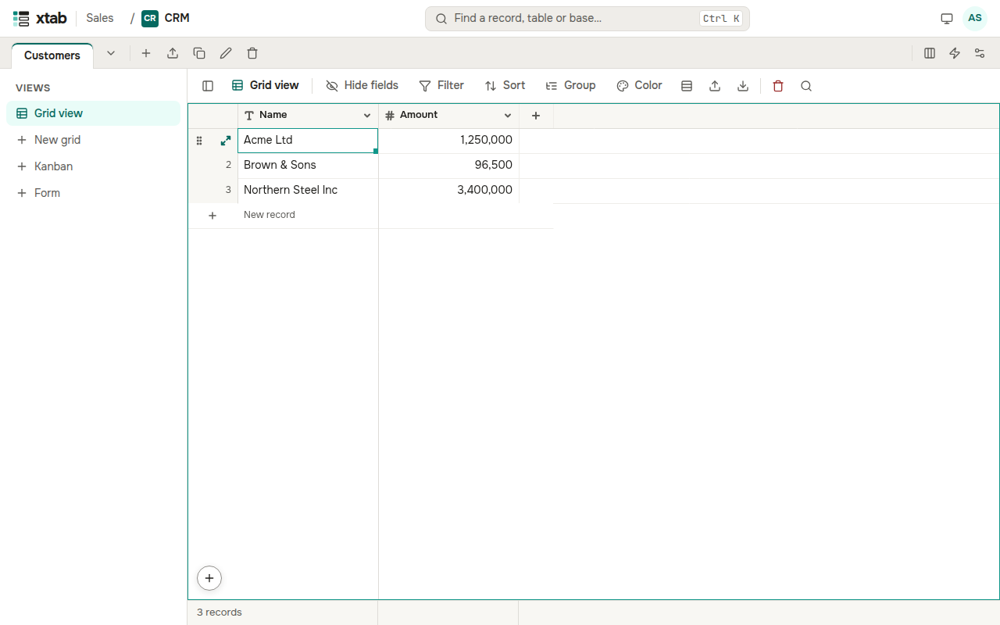

A table shows records as rows and fields as columns. The first column is the primary field of a record: it stays in place when the table scrolls to the right. The number of records in the view is shown at the bottom.

- **Select a cell:** click it. Move between cells with the arrows, Tab, Page Up and Page Down, Home and End.
- **Change a value:** press Enter or double-click the cell, or just start typing. Enter or Tab save the value, Esc cancels the edit. Numbers can be typed with commas: `1,250,000.50`. In a **Multiple select**, **User** or **Link** cell the letters you type go into the search of its list; in a **Single select** cell a letter picks the first option that starts with it. In a date cell the first character opens the date field — type the date there.
- **Checkbox:** press Enter or click the selected cell again.
- **Clear a cell:** press Delete.
- **New record:** click the round button **+** in the lower left corner of the table (its hint is «New record») — it shows at any scroll and at the end of the scroll covers no record — or the row **New record** under the last record. In a grouped table the button adds the record to the group of the selected cell, or to the last group when no cell is selected.
- **New record below the selected one:** press Shift+Enter. The items **Insert record above** and **Insert record below** of the right-click menu add a record above or below the selected one too.
- **Delete a record:** select any of its cells, click the bin above the table and confirm.

Fields the system fills (created time, created by, autonumber) cannot be changed.
