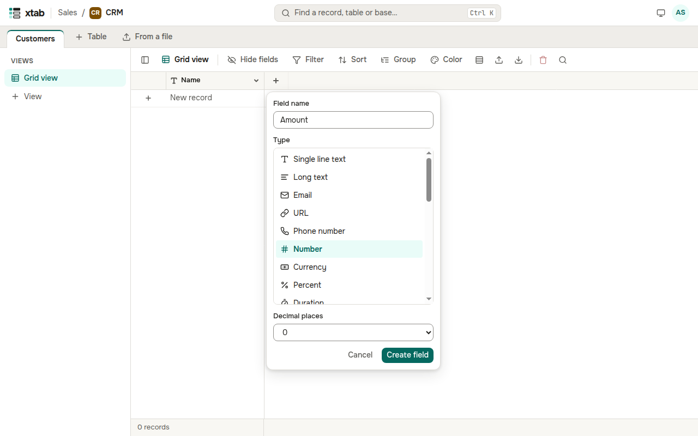
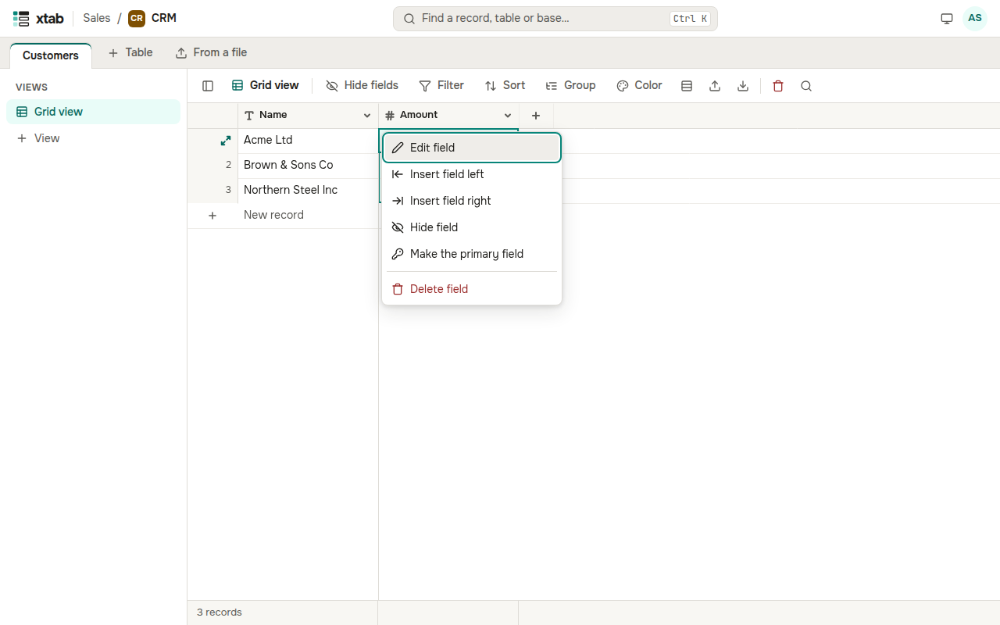

Every field has a type, and its icon is shown in the column header.

- **Text and contacts:** single line text, long text, email, URL, phone number.
- **Numbers:** number, currency, percent, duration, rating.
- **Choices:** checkbox, single select, multiple select, user.
- **Dates:** date, date and time.
- **Links between tables:** link, lookup, count, rollup.
- **Calculations:** formula.
- **Files:** attachments.
- **Filled in by the system:** autonumber, created or last modified time, created or last modified by.

**A new field at the end of the table:** click **+** to the right of the last column, enter a name, choose a type and click **Create field**.

**The menu of a field:** click the header of its column.

- **Edit field** — a new name, the options of a list (one per line), the number of decimal places, or the text of a formula.
- **Insert field left** or **right** — a new field next to this one.
- **Make the primary field** — the field becomes the first column and the name of the record: its value is what links, the quick switcher and the record title show. A formula can be the primary field too.
- **Hide field** — the column disappears from this view; the data stays.
- **Delete field** — the field is deleted with all its values after you confirm. The primary field cannot be deleted.
