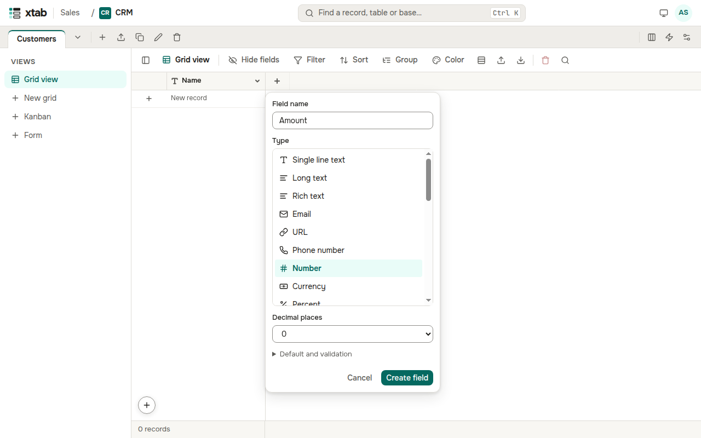
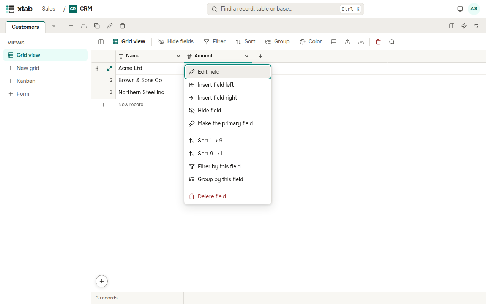
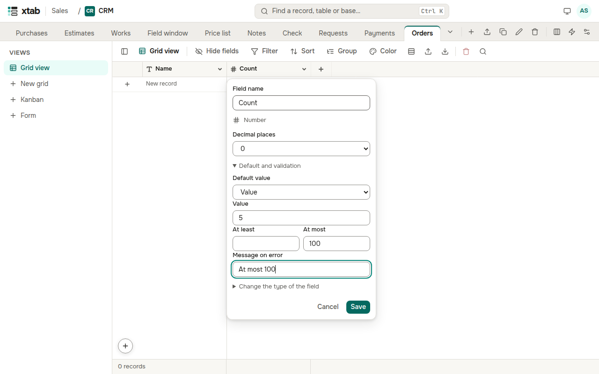
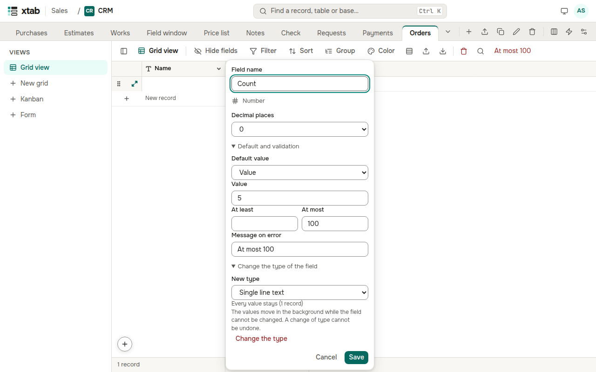

Every field has a type, and its icon is shown in the column header.

- **Text and contacts:** single line text, long text, email, URL, phone number.
- **Numbers:** number, currency, percent, duration, rating.
- **Choices:** checkbox, single select, multiple select, user.
- **Dates:** date, date and time.
- **Links between tables:** link, lookup, count, rollup.
- **Calculations:** formula.
- **Files:** attachments.
- **Filled in by the system:** autonumber, created or last modified time, created or last modified by.

**A new field at the end of the table:** click **+** to the right of the last column, enter a name, choose a type and click **Create field**. For "Single select" and "Multiple select" fields add the options here too with **Add option** (Enter in the name of an option adds the next one, and a pasted list adds an option per line) and pick their colours; the default and validation can be set at once, in the same section as in the **Edit field** window.

**The menu of a field:** right-click the header of its column, or click the arrow ▾ at the right of the header. A plain click on a header selects the column. From the keyboard — Ctrl+Shift+F10 on a selected cell of the column; a new field from the keyboard — the item **Insert field right** or **left** of this menu. In every menu the arrows ↑ and ↓ move between the items, Enter chooses one, Escape closes the menu and goes back where it was opened from.

- **Edit field** — a new name, the options of a list and their colours, the number of decimal places, or the text of a formula. Every option has its row: the name, the colour dot (opens the palette), the buttons "move up", "move down" and "delete"; the order also changes by dragging the handle on the left, or with Alt+↑ / Alt+↓ in the name. A corrected name renames the option: records keep it, with the new name. If you delete an option that records hold, xtab tells how many records will lose that value before it saves. New options get different colours at once. A link switches **One record only** here (if a record already has several links, xtab says so) and shows its inverse field with **Go to the field**; a rollup changes its expression and condition (the values are recounted after saving). The link field and the field of the linked table of a lookup, a count and a rollup are shown but do not change: they are set when the field is created — to choose others, create a new field. If the field is changed while the window is open — by you in another window or by another user — the window stays open and shows «The field was changed in another window or by another user.» with **Refresh**: it shows the new settings and, if you have changed more than the name, asks first whether to lose those changes.
- **Insert field left** or **right** — a new field next to this one.
- **Make the primary field** — the field becomes the first column and the name of the record: its value is what links, the quick switcher and the record title show. A formula can be the primary field too.
- **Hide field** — the column disappears from this view; the data stays.
- **Sort** (A → Z or Z → A, 1 → 9 or 9 → 1 for numbers, oldest first or newest first for dates, in the order of options or in the reverse order for a select) — the view is sorted by this field first, the other keys of the sort follow it.
- **Filter by this field** — the filter panel opens with a new condition on the field.
- **Group by this field** — adds a level of grouping; inactive when the view groups by the field already or has three levels.
- Without the right to change the view, sorting, filtering and grouping from the menu apply to you only, as in the panels.
- **Delete field** — the field is deleted with all its values after you confirm. The primary field cannot be deleted.

**Default and validation** — a section of the window of a new field and of the **Edit field** window. The default goes into a new record: a text or a number, **Today** and **Now** for dates, **The one who creates the record** for a user field, **Checked** for a checkbox, an option or several options for list fields. Options appear in the list of the value as soon as you type them, without saving the field first; an option removed or renamed stops being the default. Validation does not let a wrong value be saved: **At least** and **At most** for numbers, **Length from** and **Length up to** for text, **Pattern** — for example, `[A-Z]{2}-\d{3}` for a code like "AB-123". In **Message on error** write what the person should fix.

**Change the type of the field** — a section of the same window. Choose the **New type**: xtab checks the values and shows whether all of them are kept or how many become empty, with examples, and for numbers how many will be rounded to the decimal places of the new type, with the first one before and after. Click **Change the type**: the values move in the background, and the field cannot be changed meanwhile. A change of type cannot be undone — if important values do not convert, create a new field instead.

