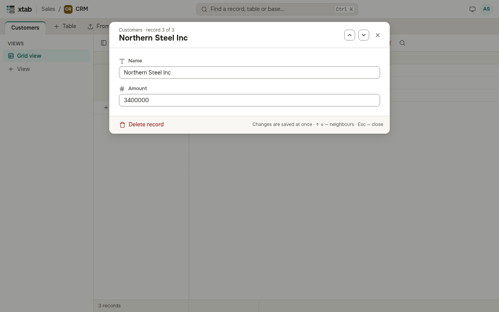

To see every field of one record at once, select one of its cells and press Space, or click the number of its row on the left.

- Change any field: the value is saved as soon as you leave the field or choose an option.
- The arrows ↑ and ↓ (or the buttons at the top) open the neighbouring records.
- Esc or the cross closes the window.
