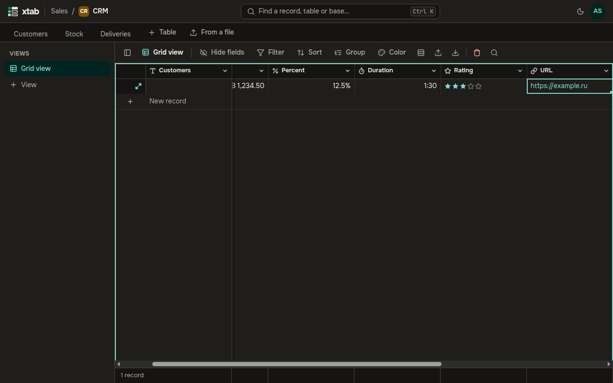
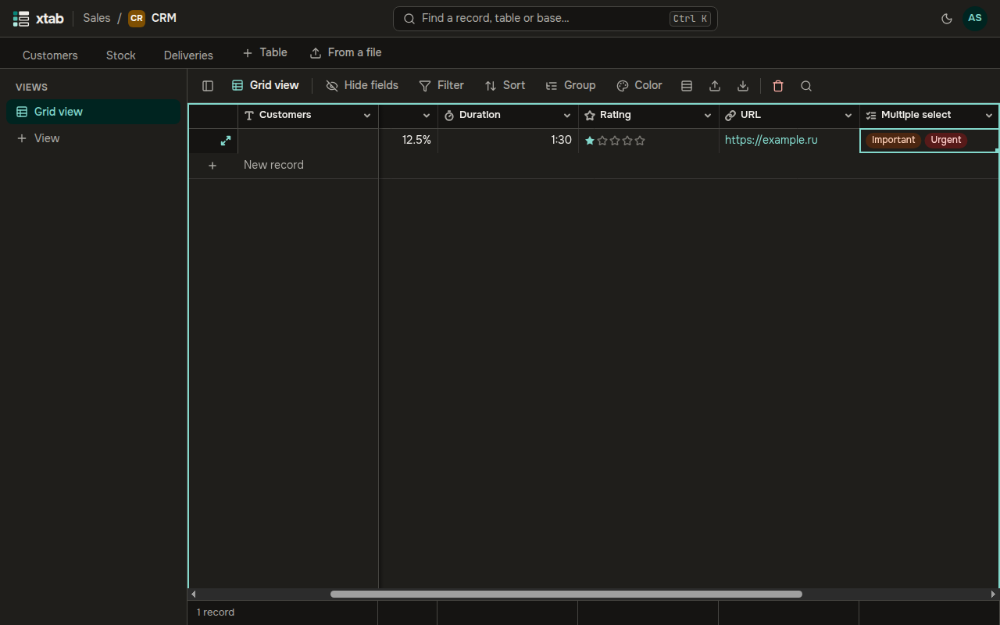

- **Currency, percent, duration:** type the way you are used to: `1,234.50`, `12.5`, `1:30`. xtab adds the currency sign, the percent sign and the hours and minutes.
- **Rating:** click the star you want.
- **Email and URL:** the address becomes a link.

- **Multiple select:** select the cell and press Enter, then tick the options. They appear in the cell in the order you ticked them.
- **User:** press Enter, start typing a member's name and pick them from the list. The field setting **Several people in a cell** allows more than one person.

