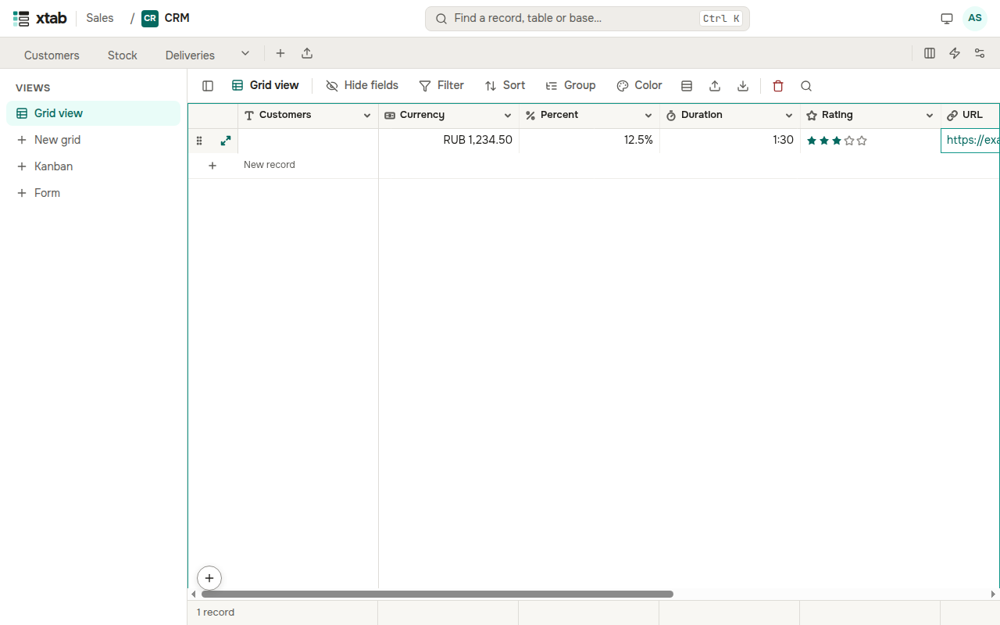
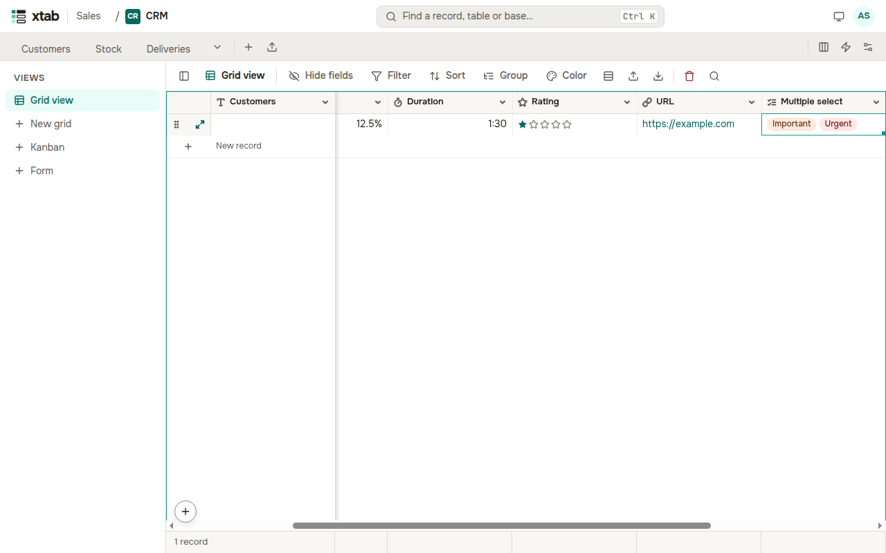

- **Currency, percent, duration:** type the way you are used to: `1,234.50`, `12.5`, `1:30`. xtab adds the currency sign, the percent sign and the hours and minutes. If the currency sign is not needed in a table, clear **Show the currency sign** next to the currency in the **Edit field** window — the amount keeps its decimal places and thousands separators, in the grid, summaries, the record window, forms, kanban and interfaces. This is only how it looks: the value, filters, sorting and export do not change.
- **Rating:** click the star you want.
- **Email and URL:** the address becomes a link.

- **Date and time, created time and last modified time:** to see the date alone, clear **Show the time** in the **Edit field** window — the same for a formula, a lookup and a rollup that give a date with time. The date is shown in your time zone. This is only how it looks: the time is still kept and can be entered, and filters, sorting, grouping and export work with the whole value. In the record window a date and time field shows its time too, so that it can be corrected.
- **Multiple select:** select the cell and press Enter or start typing the name of an option — the search keeps the matching ones. Tick the options: they appear in the cell in the order you ticked them.
- **User:** press Enter or just start typing a member's name on the selected cell, and pick them from the list. The field setting **Several people in a cell** allows more than one person — then the right edge of the cell shows how many people it holds. A member who has not given a name in the profile is shown as “No name”.

