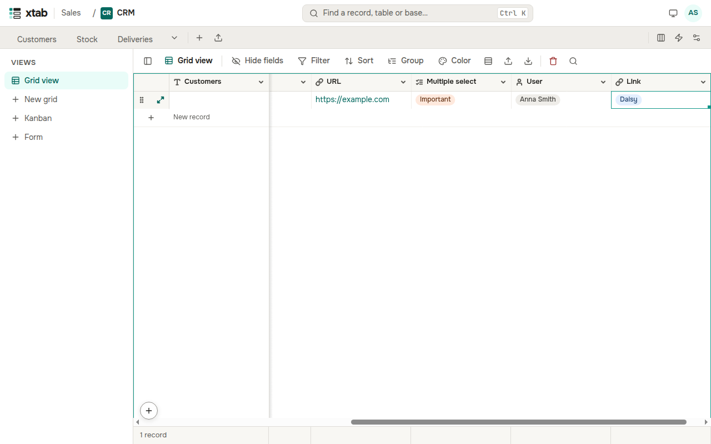

A **Link** field connects a record with records of another table: for example, a customer with their suppliers.

**Create a link:** add a field of type **Link** and choose the **Linked table**. Turn on **One record only** if a cell should hold a single record. The linked table gets an inverse field, so the link is visible from both sides. Its name is set right there, in **Name of the inverse field**: it starts as the name of this table, and if the linked table already has a field of that name — as the name of the table with the name of the new link in brackets, for example "Contracts (Budget)". You can change it; if the name is taken, xtab says so under the field. Which field is the inverse one shows in the **Edit field** window of the link — the line "Inverse field: “…” in the table “…”", and **Go to the field** opens the linked table with the column of that field selected (if the field is hidden in the view, xtab says so) — and in the hint over the header of the link column. A link of a table with itself has no inverse field: it says "No inverse field".

**Link records:** select the cell and press Enter or just start typing the name of a record, find the record and pick it from the list. The cross on a pill removes the link. When there is little room under the cell, the list opens above it. A record whose primary field is empty is shown as “Untitled”. When a cell may hold several records, its right edge shows the number of all its links, and the names that do not fit are cut with an ellipsis.

**The list to choose from** is the same in a cell, in the window of a record, in forms and in the conditions of a filter — people and the options of a **Multiple select** field are chosen the same way. Outside a cell it is a compact field: what is chosen shows in it as pills with a cross (or as a name, when one value is chosen), and the list opens under the field — or above it when there is little room below — on a click, as you type or by ↓, without stretching the form. Long names are cut with an ellipsis and shown whole in a tooltip. The list shows records in portions: scroll it down and the next ones load; typing a part of a name narrows the list. From the keyboard: ↑ and ↓ move along the items, Enter chooses (when several may be chosen, the list stays open), Esc closes the list, Backspace in an empty field removes the last pill. When there are very many records, after 10,000 the list stops with “The first … are shown — narrow the search”; when it could not be loaded, it says “The list could not be loaded — try again”.

- Links can be pasted from the clipboard as the names of the linked records.

**Choose only fitting records:** in the settings of a **Link** field (the menu of the header → **Edit field**) the section **Choose only records where…** narrows the list to choose from. Conditions are set as in a filter of a view — on the fields of the linked table and of the tables further along its links (for example, **Project → Customer**). The button **Condition on a field of this record** compares a link or a user of the candidate with the value of a field of the record being filled in: for example, «**Project** has any of **Project of this record**» — a Contract offers only the Budgets of the Project chosen in it.

A row of such a condition has two sides, each captioned with whose it is. The left one — **In the record of the list** (the record of the linked table offered to choose): its field or a path along the links from it. The right one — **In this record** (the record being filled in): its field the left one is compared with. With the sides mixed up the condition narrows nothing, so a warning appears under the row — such a condition can be saved all the same. «The path leads back to the table …» — the left path starts with a link back to the table of this record (for example, **Budgets → Project** on the left for the field **Items** of the table **Budgets**): the condition checks other records of that table, not the one being filled in. Such paths come last in the list of the left side. «This field is filled in by this choice…» — the right side is the field being set itself or a path through it (for example, **Items → Group of this record** for the field **Items**): while the field is empty, the condition does not narrow the list.

- While the field of this record is empty, its condition does not narrow the list, and a hint above the list says «Choose «Project» to narrow the list». A form takes its values at once, before they are saved.
- A link chosen already that no longer fits (the Project was changed, say) is not removed: in the list to choose from, in the window of the record and in a form it is marked with the icon «Does not fit the condition of the field».
- The condition only helps to choose: pasting, imports, the API and automations write any links.
- If a field of the condition is deleted, that part of the condition stops acting — the choice gets wider — and the settings of the field say «A part of the condition refers to a field that is gone and does not act».
- If the list was not found in time, «The records were not found in time — refine the search» appears: type a part of the name.
- Records can be filtered, sorted and grouped by a link — by the names of the linked records.
- An export writes the names of the linked records.
