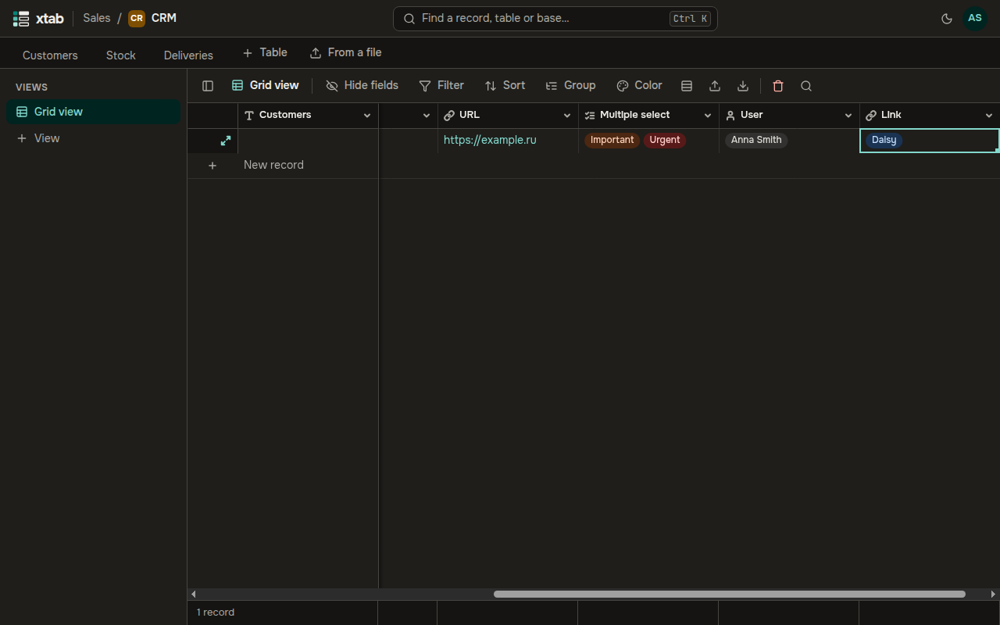

A **Link** field connects a record with records of another table: for example, a customer with their suppliers.

**Create a link:** add a field of type **Link** and choose the **Linked table**. Turn on **One record only** if a cell should hold a single record. The linked table gets a field back, so the link is visible from both sides.

**Link records:** select the cell and press Enter, find a record by its name and pick it from the list. The cross on a pill removes the link.

- Links can be pasted from the clipboard as the names of the linked records.
- Records can be filtered, sorted and grouped by a link — by the names of the linked records.
- An export writes the names of the linked records.
