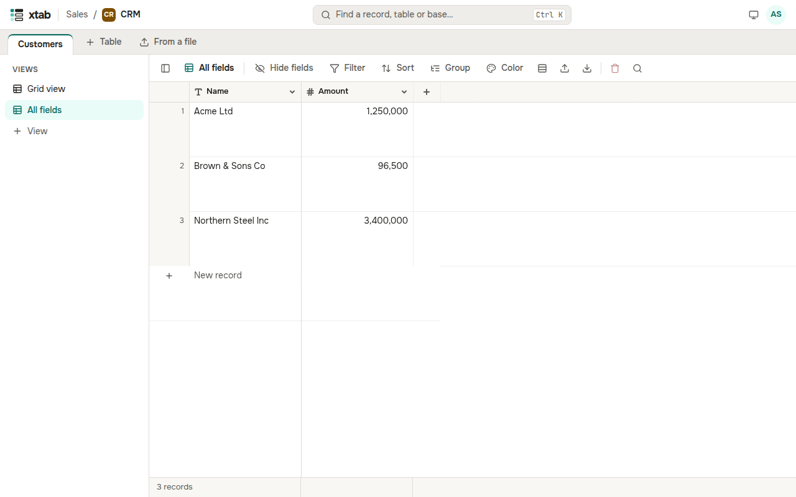

A view is a way of looking at a table: which fields are visible, in what order and how wide the columns are, which records are picked and how they are sorted, grouped and coloured. A table can have many views; they share the data. The list of views is to the left of the table; the panel button at the start of the bar above the table hides and shows it.

- **New view:** click **+ View** in the list on the left, enter a name and press Enter. A new view shows every field.
- **Rename, duplicate, delete:** point at a view in the list and click the pencil, the copy icon or the bin. The last view of a table cannot be deleted.
- **Hide fields:** click **Hide fields** above the table and switch off the fields you do not need; **Hide all** and **Show all** do it at once.
- **Row height:** click the rows icon above the table and choose **Short**, **Medium** or **Tall**.
- **Column width:** drag the right edge of the header of a column.

Every view remembers its own settings. Everyone who opens a view sees it the same way.
