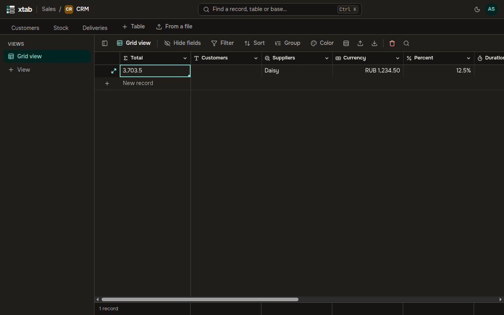
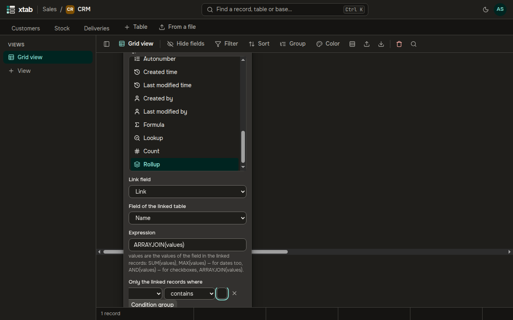
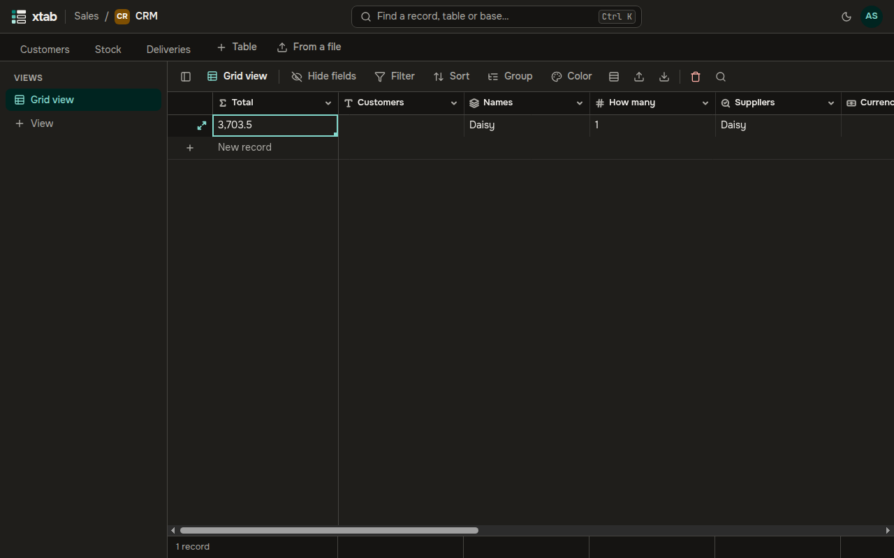

These fields take data from linked records and update themselves when the linked records change.

- **Lookup** shows the values of a chosen field of the linked records, such as the cities of the suppliers. In the field form choose the **Link field** and the **Field of the linked table**.
- **Count** counts the linked records. Choose the **Link field**.

- **Rollup** computes one value over the linked records. Choose the **Link field** and the **Field of the linked table**, then enter an **Expression**. `values` in it stands for the values of the field in the linked records:
  - `SUM(values)` — the sum;
  - `MAX(values)` — the largest value, dates included;
  - `AND(values)` — for checkboxes;
  - `ARRAYJOIN(values)` — all values separated by commas.

  **Only the linked records where** limits the rollup to the matching records; its conditions work the same way as in a filter.

