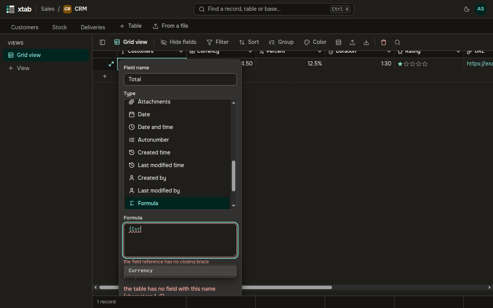
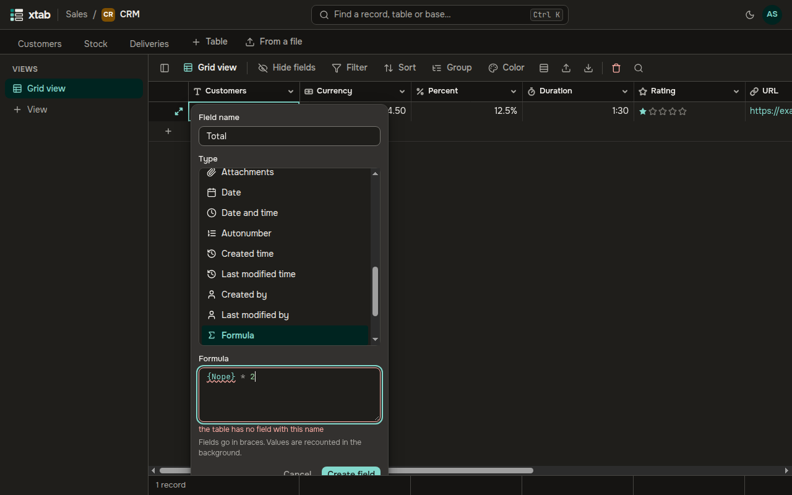
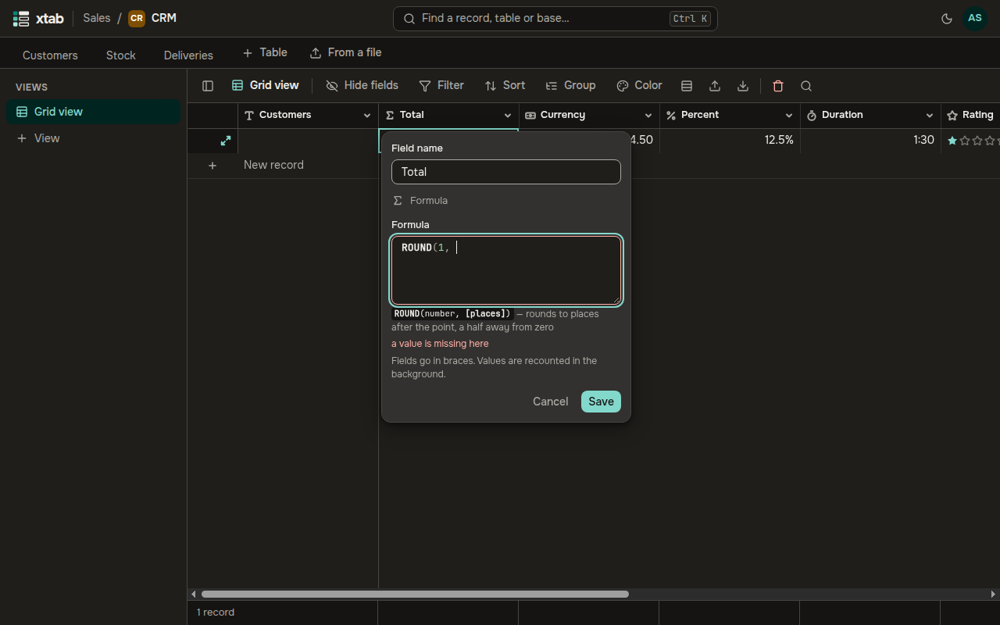
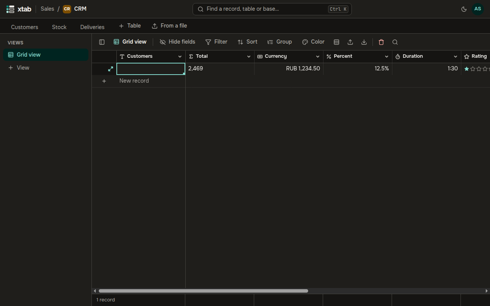
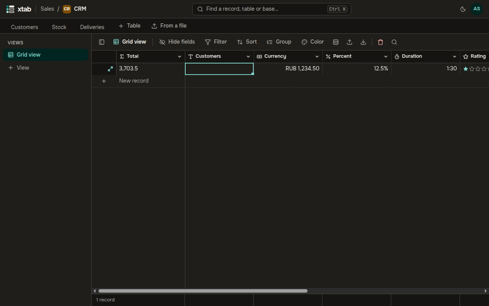

A **Formula** field computes a value from other fields of the record, for example `{Price} * {Quantity}`.

1. Add a field of type **Formula** and type the formula. Field names go in braces.
2. After `{` xtab offers the fields, and as you start typing a function name it offers the functions. Choose one with the arrow keys and press Enter.

   

3. A mistake is underlined at once, and the text below the formula says what is wrong.

   

4. While you type a function, the text below the formula shows its arguments and what it does.

   

5. The line **On the selected record:** shows the result on the current record.
6. Click **Create field**.

A formula recounts by itself when the fields it depends on change. In a big table the recount runs in the background, and the values update as it goes.

The functions are the ones you know from Excel and Airtable:

- arithmetic and rounding: `ROUND`, `SUM`, `AVERAGE`;
- conditions: `IF`, `SWITCH`, `AND`, `OR`;
- text: `CONCATENATE`, `LEFT`, `UPPER`, `SUBSTITUTE`;
- dates in the time zone of your organization: `TODAY`, `DATEADD`, `DATETIME_DIFF`, `DATETIME_FORMAT`, `WORKDAY`;
- lists: `ARRAYJOIN`, `ARRAYUNIQUE`;
- regular expressions: `REGEX_MATCH`.

You can filter, sort, group and summarize by the result of a formula. A formula can also be the primary field, so that records are named by its value.

