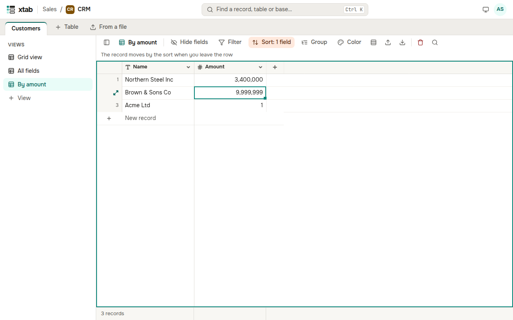

Click **Sort** above the table, then **Add sort**, choose a field and a direction. The second and further sorts order the records with equal values of the first one. Without a sort, records come in manual order — the order you added them in.

If you change a value and the record should move by the sort or disappear by the filter, it stays in place until you leave the row; a hint above the table says so.

If you have no right to change the view, you can still set a filter and a sort: only you see them, and they reset when the page reloads. The bar above the table then shows **Temporary filter and sort** with a **Reset** button.
