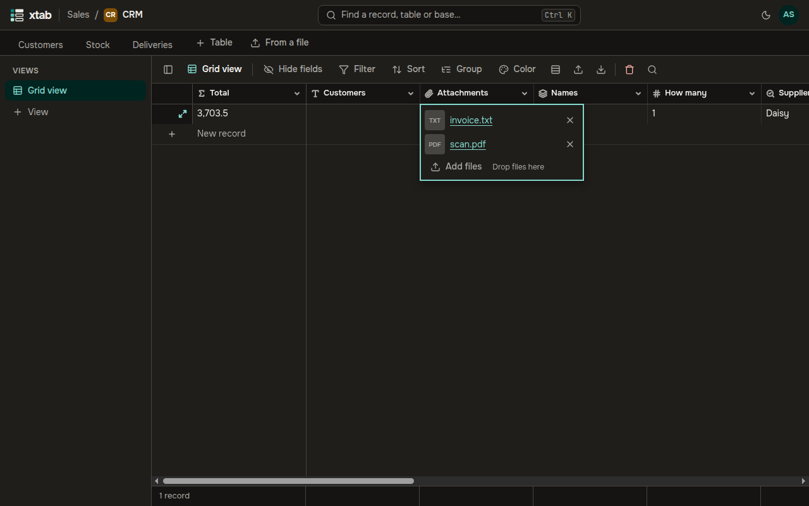
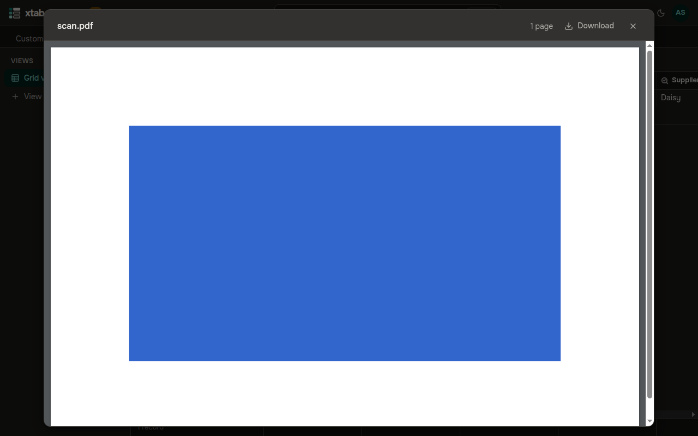

An **Attachments** field holds files: contracts, scans, photos.

- **Add files:** select the cell and press Enter, then click **Add files**, or drop the files onto the cell's window. A cell holds up to 100 files.
- **Open a file:** click its name.
  - Images, video and sound open in a new tab.
  - A PDF opens in a viewer right inside xtab.
  - Other files are downloaded.
- **Remove a file:** click the cross to the right of its name. If you removed a file by mistake, undo (Ctrl+Z) and it comes back.

Images get thumbnails, which show right in the table. When a photo is uploaded, xtab removes the information about where it was taken, the camera and the author.

In the PDF viewer:

- scroll to turn the pages;
- the top bar shows the number of pages and a **Download** button;
- Esc or the cross closes the viewer.

A password-protected document has to be downloaded to open.

