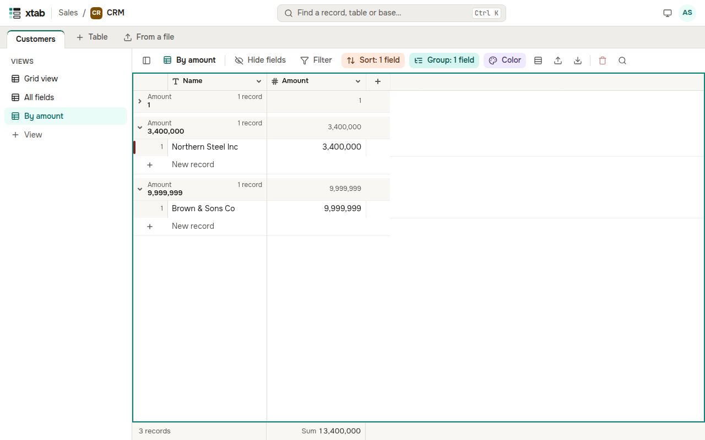

Click **Group** above the table, then **Add grouping** and choose a field: records with the same value gather in a group with a header and the number of records. You can group by several fields.

- Click the arrow in the header of a group to collapse or expand it; **Collapse all** and **Expand all** are in the grouping panel.
- The row **New record** at the bottom of a group adds a record with its value already set.
