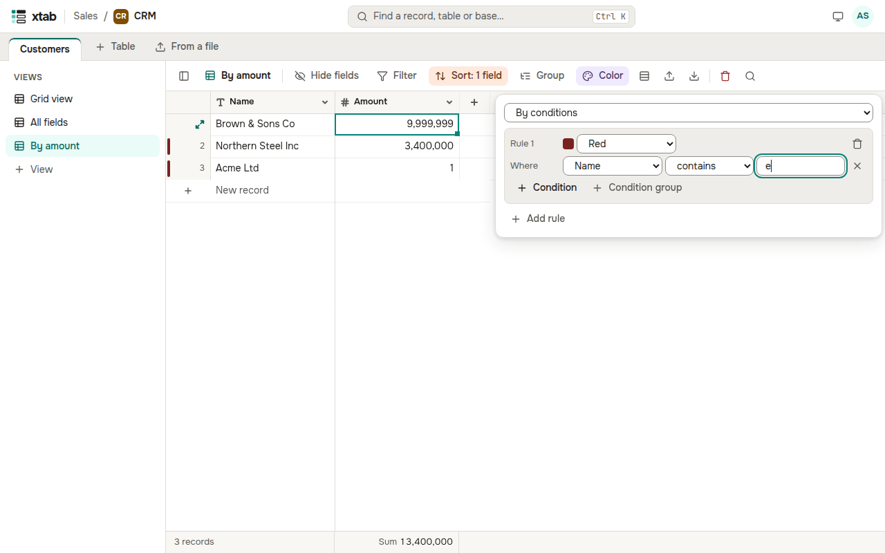

Click **Color** above the table and choose how to colour records:

- **By a single select field** — a stripe to the left of a record takes the colour of its option;
- **By conditions** — set a rule: a colour and conditions, as in a filter. **Add rule** adds another one; a record takes the colour of the first rule it meets.

