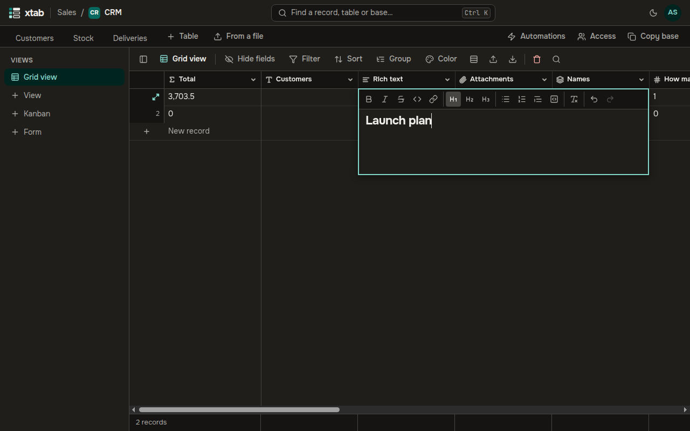

The field **Long text with formatting** keeps notes, descriptions and instructions with headings, lists, links and quotes.

- **Edit:** select the cell and press Enter, or double-click it, to open the editor. The buttons on top: headings, bold, italic, strikethrough, code, link, lists, quote, code block, clear formatting, undo and redo.
- **Save** with Ctrl+Enter or Tab (Tab also moves to the next cell); **cancel the edit** with Esc.
- Links go only to `http://`, `https://` and `mailto:` addresses.
- Text from Word, a browser or mail is pasted with its headings, lists and links; other formatting is dropped.
- The table shows the start of the text without formatting, the whole of it is in the record window.
- Search, filters and formulas work with the text without formatting; on export the field is written as Markdown.

