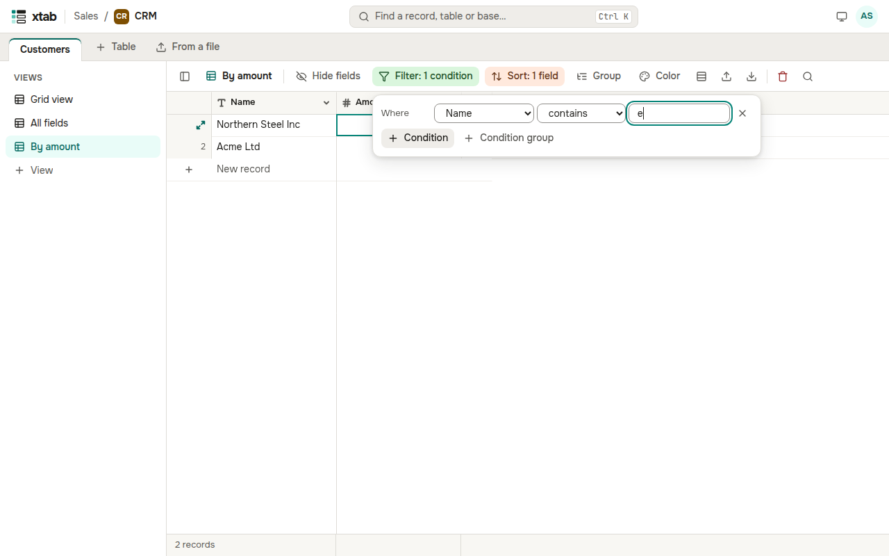

A filter keeps only the matching records in a view. Click **Filter** above the table, then **+ Condition**: choose a field, a condition (for example «contains», «greater than», «today») and a value. Several conditions are joined by «and» or «or»; **+ Condition group** puts conditions in brackets.

The button lights up and shows the number of conditions. To remove a condition, click the cross to its right.
