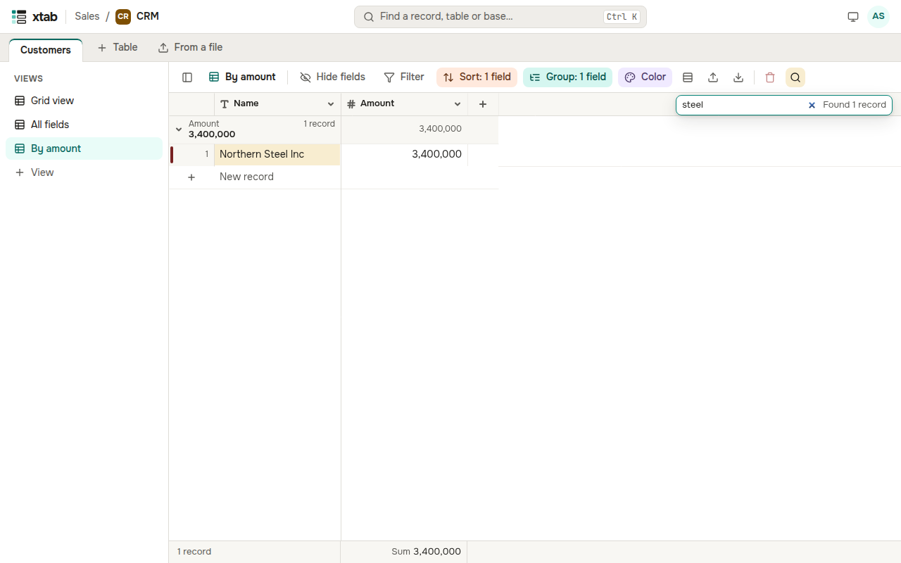

Press Ctrl+F (⌘F on a Mac) or click the magnifier above the table and type the text. The view keeps the records with that text, the matches are highlighted, and the number of records found is shown next to the search box. The cross clears the search.

