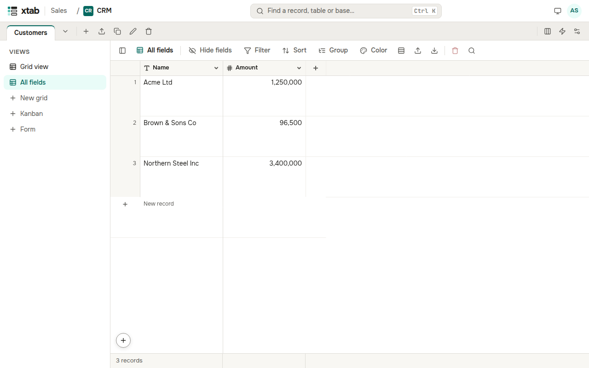

A view is a way of looking at a table: which fields are visible, in what order and how wide the columns are, which records are picked and how they are sorted, grouped and coloured. A table can have many views; they share the data. The list of views is to the left of the table; the panel button at the start of the bar above the table hides and shows it.

- **New grid:** click **+ New grid** in the list on the left, enter a name and press Enter. A new view shows every field.
- **Rename, duplicate, delete:** point at a view in the list and click the pencil, the copy icon or the bin. The last view of a table cannot be deleted.
- **The order of the views:** drag a view in the list to its new place, or go to it with Tab and press Alt+↑ or Alt+↓. The order is the same for everyone and changes for the others at once; the creator and the owner of the base may change it. A new view and a duplicate go to the end of the list.
- **Hide fields:** click **Hide fields** above the table and switch off the fields you do not need; **Hide all** and **Show all** do it at once.
- **Row height:** click the rows icon above the table and choose **Short**, **Medium** or **Tall**.
- **Column width:** drag the right edge of the header of a column.

Every view remembers its own settings. Everyone who opens a view sees it the same way.

A table opens in the view you chose in it last, both from its tab and after the page is reloaded. This is remembered for you in this browser and does not change the order of the views for the others. The address bar holds the address of the view shown: a link copied from it opens the same view for a colleague. If the remembered view was deleted, the first one opens.

On a narrow screen, such as a phone, the list of views is hidden at first so that the table takes the whole screen; the panel button opens it over the table, and choosing a view, the Esc key, a click outside the list or the cross button **Hide views** in it closes it again.
