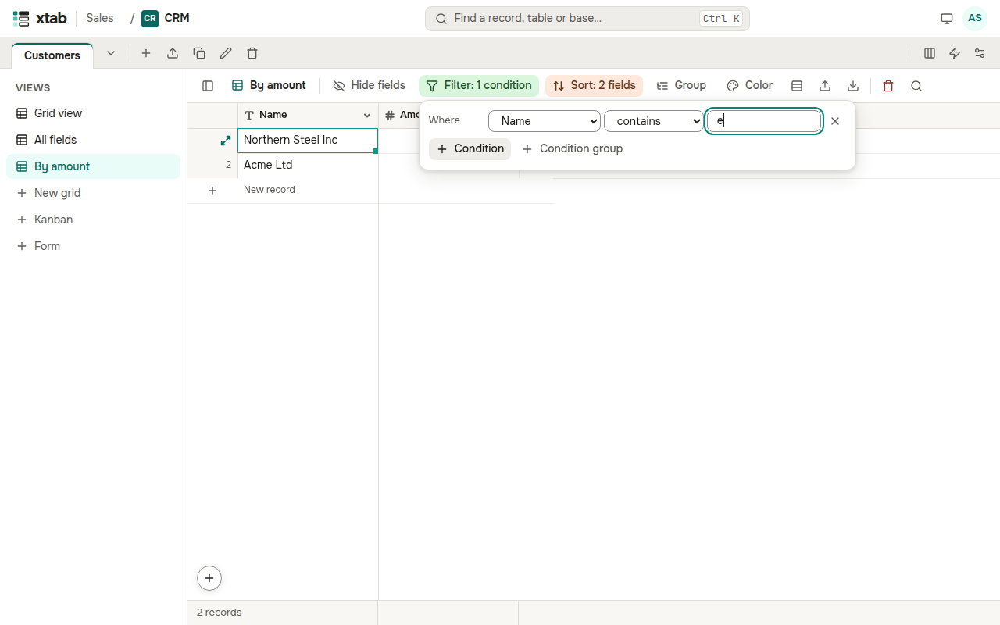

A filter keeps only the matching records in a view. Click **Filter** above the table, then **+ Condition**: choose a field, a condition (for example «contains», «greater than», «today») and a value. Several conditions are joined by «and» or «or»; **+ Condition group** puts conditions in brackets.

The button lights up and shows the number of conditions. To remove a condition, click the cross to its right.

A new record in a filtered view — by **+**, the row **New record**, Shift+Enter or rows pasted below the last one — takes the values of the filter at once, so it stays in the view. For example, with the filter «Color — Green» the field **Color** of the new record is **Green**. A value is set only when the filter leaves no choice: the condition «is» (or «is me» for a user field), a checkbox, «is any of» with one option, «has all of» and «is exactly» for a multiple select and several users. Conditions that many values meet («contains», «greater than», «is not», «is not empty», the dates «today» and periods), conditions inside an «or» group, conditions on links, dates with time and computed fields, and two conditions asking different values of one field set nothing. A temporary filter works the same way.
