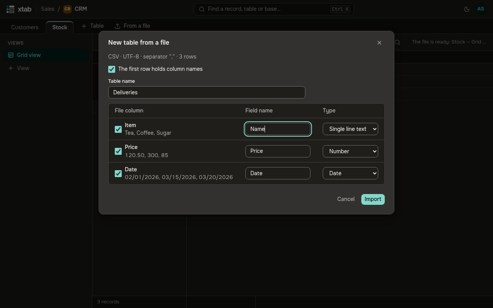

CSV and XLSX files up to 50 MB fit; xtab detects the encoding and separator of CSV itself.

- **New table from a file:** click **From a file** to the right of the table tabs.
- **Records into this table:** click the up-arrow icon above the table.

Drop a file into the window or click **Choose a file**. xtab shows the columns of the file with sample values and suggests a field and a type for each. Clear the checkbox of a column you do not need, correct the names and types and click **Import**.

- You may close the window — the import goes on; its progress shows above the table.
- If many values do not fit the fields, the import stops and shows examples: **Import anyway** or **Do not import**. **Download the report** gives a file with every row that did not fit.
- **Delete the imported records** — within a day after the import: removes the records it added. Records changed since then can be kept.
