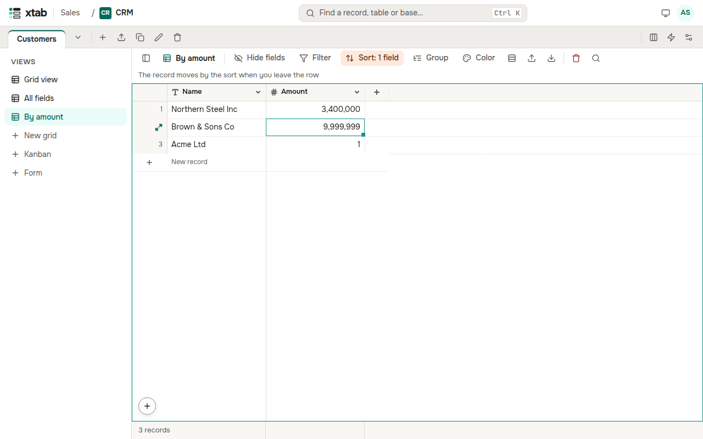

Click **Sort** above the table, then **Add sort**, choose a field and a direction. The second and further sorts order the records with equal values of the first one. Without a sort, records come in manual order — the order you added or arranged them in.

## Manual order of records

In a view without a sort you can rearrange records:

- **Drag a row by its number.** Point at a row — instead of its number it shows a grip of dots at the left and the icon that opens the record at the right. Press the number and drag the row: a line shows where it goes. To move several rows in a row, select cells in them first (drag over them or press Shift with the arrows) and drag the number of any of them. A plain click on the number opens the record, as before.
- **With the keyboard:** select a cell of the record and press Alt+↑ or Alt+↓ — the record goes one place up or down. The items **Move up** and **Move down** of the right-click menu do the same.
- **Undo a move** like any other edit — Ctrl+Z.

The manual order is one for the whole table: every user sees it in every view of the table without a sort, and others see a move at once. In a grouped view rows move within their group. When the view has a sort (a temporary one too), the sort sets the order: a drag and Alt+↑/↓ do not move records, and a hint above the table suggests removing the sort.

If you change a value and the record should move by the sort or disappear by the filter, it stays in place until you leave the row; a hint above the table says so. A new record stays in place the same way — even if it does not match the filter (also a temporary one, a search or the filter of an interface element) — and so do the records you pasted or filled values into, while the selection is on them. When you leave the row, the records go to their places, and the selected cell stays on the record you moved to. While a row stays in place, changes of other users that add, remove or reorder records appear when you leave the row; new values in visible cells show at once.

If you have no right to change the view, you can still set a filter and a sort: only you see them, and they reset when the page reloads. The bar above the table then shows **Temporary filter and sort** with a **Reset** button.
