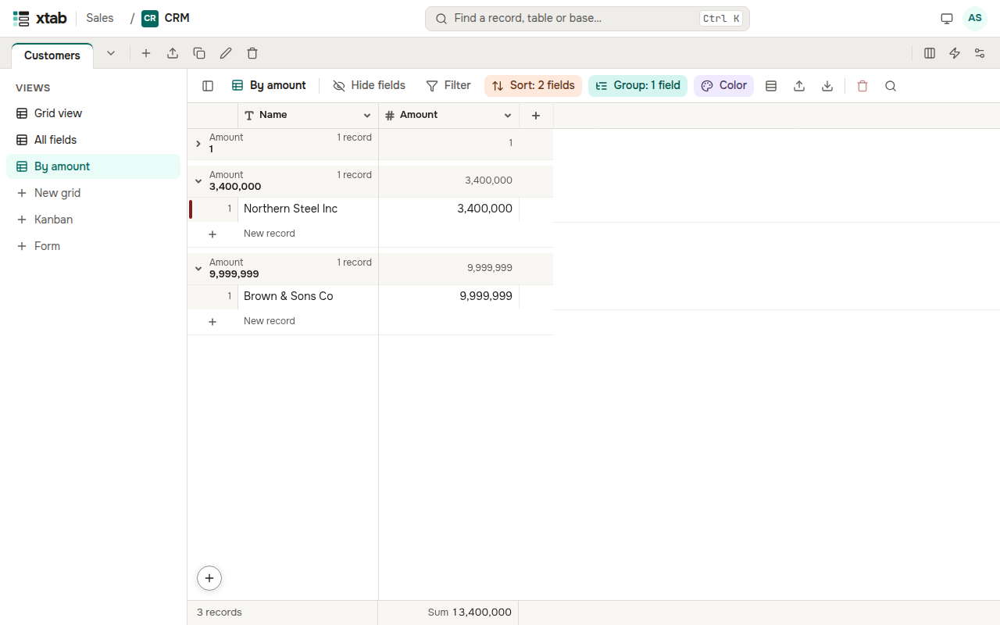

Click **Group** above the table, then **Add grouping** and choose a field: records with the same value gather in a group with a header and the number of records. You can group by several fields.

- Click the arrow in the header of a group to collapse or expand it; **Collapse all** and **Expand all** are in the grouping panel.
- The direction of a level in the grouping panel sets the order of its groups: **A → Z** or **Z → A** (**1 → 9** or **9 → 1** for numbers, **Oldest first** or **Newest first** for dates, **In the order of options** or **In the reverse order** for a select). A **Link** field also has **In record order** — the groups follow the order of the records in the linked table: drag the rows there (say, «Turnkey contract» above «Decor») and the groups in every view and interface rearrange themselves within a second or two; a hint under the level names that table. If you group only for yourself (without the right to change the view), the grouping resets when the page reloads, and a new order of groups shows when you choose the grouping again. A group of several linked records goes by the first of them, then by the next ones; the group without links is last.
- The row **New record** at the bottom of a group adds a record with its value already set (over the values of the filter) — in a group by a link, with the same linked records; the record shows at the end of the group and stays there while you are on it. The exception is a group by a **Date and time** field: it gathers the records of one day, and the new record gets no time.
- If you change the value of the grouping field — in the cell editor, by pasting or by filling — the record stays in its group with the hint «The record moves to another group when you leave the row». When you leave the row, the record goes to its new group and the numbers in the headers are counted again.
