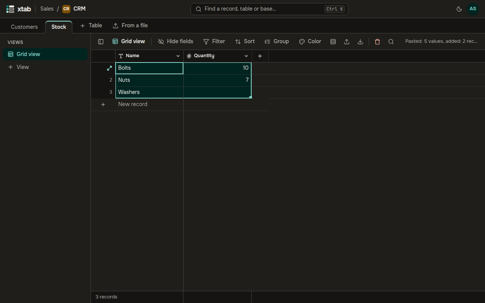

- **Select a range:** drag the mouse over cells or press the arrows with Shift; Ctrl+A selects every cell of the view.
- **Copy and paste:** Ctrl+C, Ctrl+X and Ctrl+V — also from Excel and Google Sheets and back. If you paste more rows than there are records below, the missing records are added. The bar above the table shows how many values were pasted and which did not fit the fields.
- **Fill down:** drag the small square in the bottom right corner of the selection or press Ctrl+D — the values of the top row are copied down.
- **Clear cells:** Delete.
- **Range menu:** right-click the selection — copy, cut, fill down, clear cells, delete records.

