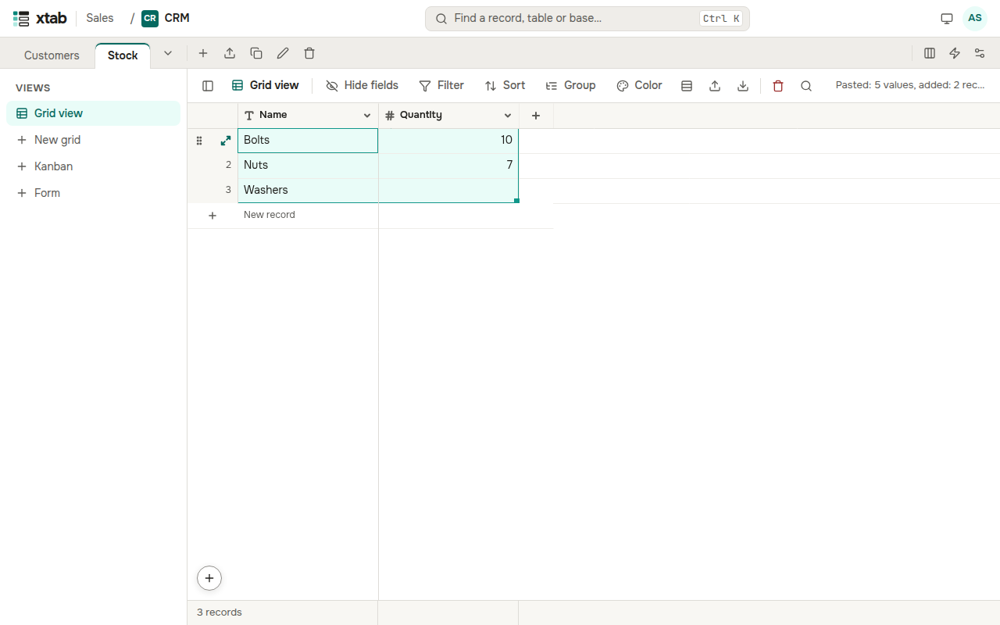

- **Select a range:** drag the mouse over cells or press the arrows with Shift; Ctrl+A selects every cell of the view.
- **Copy and paste:** Ctrl+C, Ctrl+X and Ctrl+V — also from Excel and Google Sheets and back. If you paste more rows than there are records below, the missing records are added. The bar above the table shows how many values were pasted and which did not fit the fields.
- **Fill down** (Ctrl+D or the item of the right-click menu): with several rows selected, the values of the top row of the selection are copied to every row below it; with one cell or one row selected, it takes the value of the record above. The first row of the table has nothing to fill: the menu item is inactive and Ctrl+D says «Nothing to fill: select several rows». In a grouped table the value comes only from the same group: the first record of a group does not take the value of the neighbouring one. Links are copied with all the linked records; attachments are not copied — a file belongs to one cell, and the status line says so.
- **Fill handle:** drag the small square in the bottom right corner of the selection down — the top row of the selection is copied to every row down to where you release the mouse button.
- **Clear cells:** Delete.
- **After pasting, filling and clearing** the selection stays on the same records. If the records should go to another group or move by the sort, they stay in place with a hint above the table while the selection is on them; when you leave them, they go to their places.
- **Range menu:** right-click the selection or the number of a row (the whole row is selected) — copy, cut, fill down, clear cells, delete records. From the keyboard — Shift+F10 or the menu key on the selected cell. Paste only with Ctrl+V: the browser does not let a page read the clipboard, so the item **Paste** of the menu is inactive.

