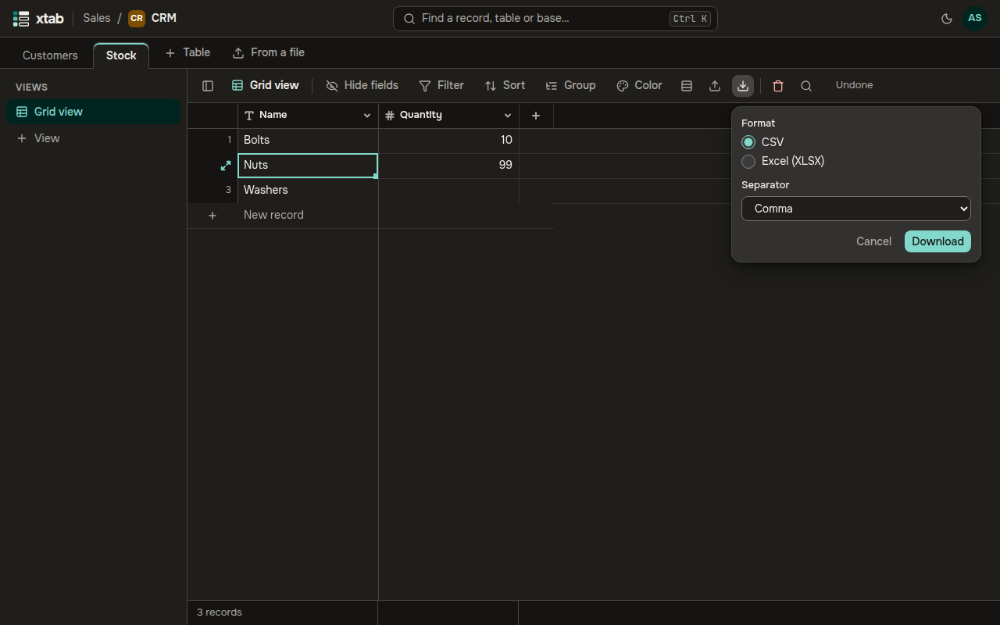

Click the down-arrow icon above the table, choose a format — **CSV** or **Excel (XLSX)** — and for CSV a separator, then **Download**. The file gets the records and fields of the view, with its filter and sort. If there are more than 1000 records, xtab asks for your password again.

