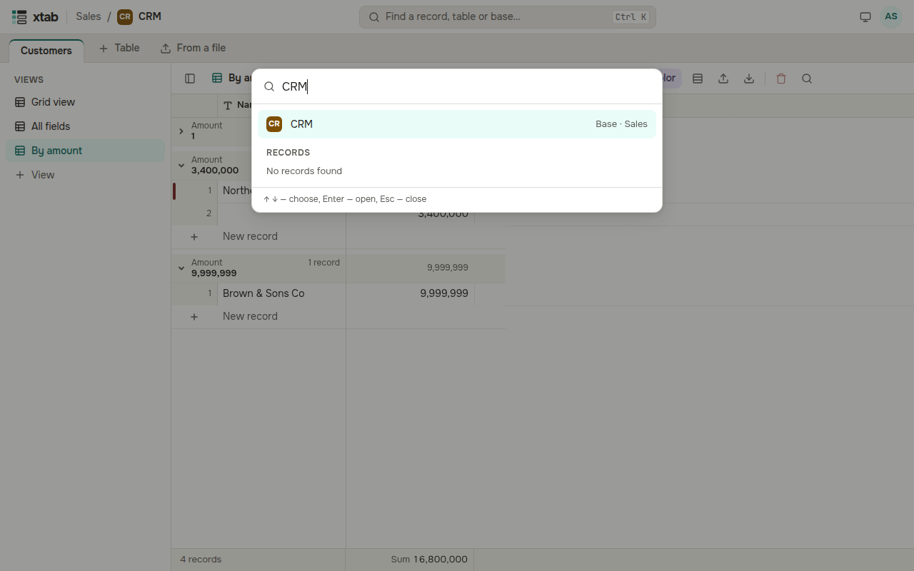
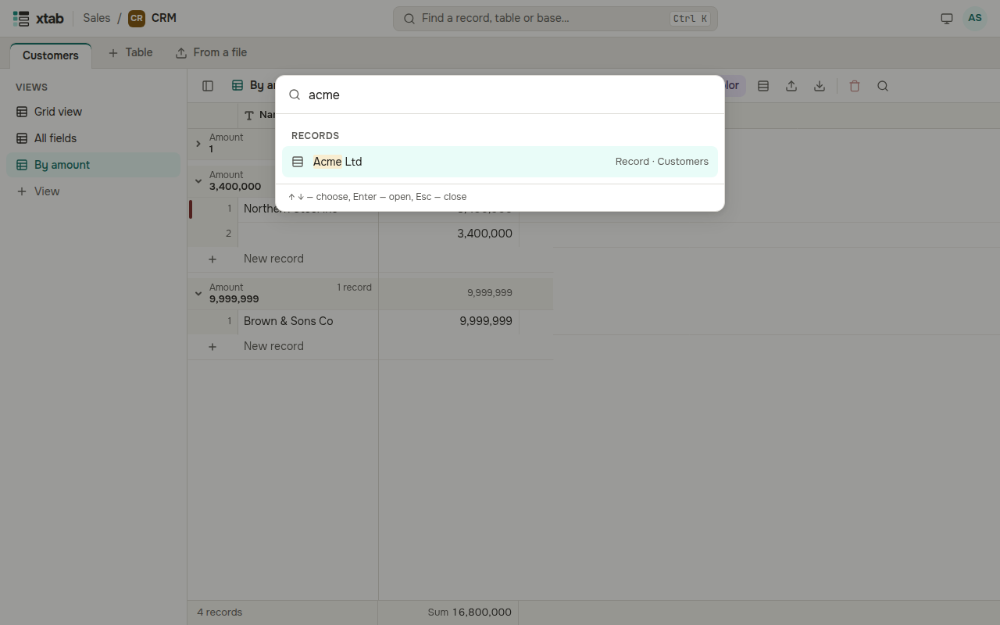

Press Ctrl+K (⌘K on a Mac) or click **Find a record, table or base…** at the top. Start typing the name of a base or a table or the text of a record, choose a result with the arrows and press Enter.

A record found opens expanded in its table.

