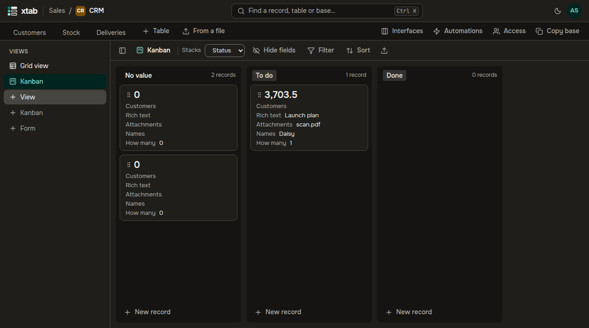

A kanban shows records as cards in stacks, by a single select or a user field. It suits tasks, requests and deals moving through stages.

- **Create:** click **+ Kanban** in the list of views on the left, type a name and press Enter, then choose the field in the list **Stacks**.
- There is a stack for every option of the field and one for **No value**; the header of a stack shows the number of its cards.
- A card shows the primary field and the next fields of the table; hide the ones you do not need with **Hide fields** above the kanban. Filter and sort work as in the table.
- **Move a card:** drag it with the mouse or a finger to another stack or another place, and the value of the field changes by itself. With the keyboard, select the card and press Alt with an arrow.
- **Open the record:** click the card or press Enter.
- **New record** at the bottom of a stack creates a record with the value of that stack.

