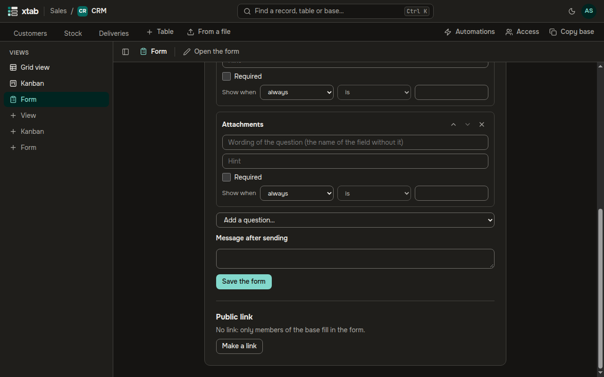
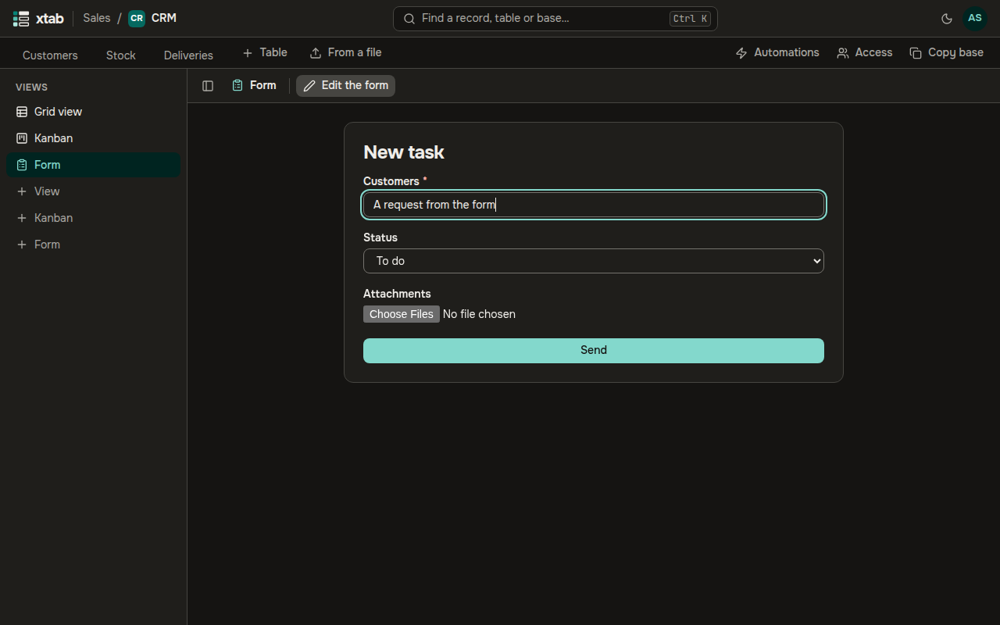
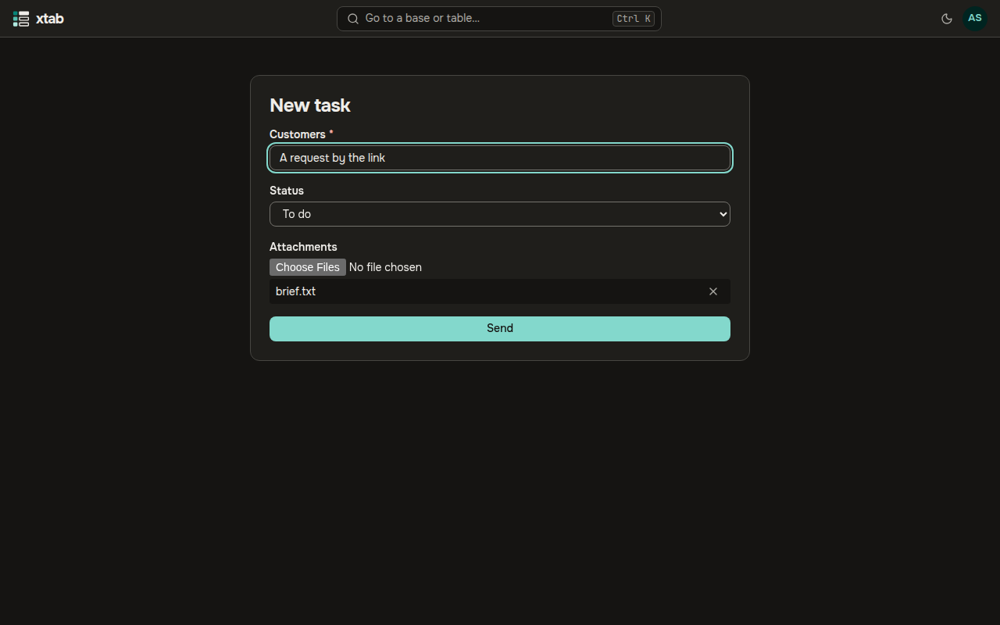

A form collects records into a table: the members of the base fill it in inside xtab, and anyone can fill it in by a public link without signing in.

- **Create:** click **+ Form** in the list of views on the left, type a name and press Enter; the builder opens.
- In the builder set the title, the description and the message after sending. **Add a question…** picks a field of the table. A question can have its own wording (without it the name of the field is shown), a hint, the mark **Required** and a condition **Show when**, so it appears only after a certain answer to an earlier question. **Up**, **Down** and **Remove the question** change the order and the set. Click **Save the form**.
- A form asks fields that are filled in by hand: texts, numbers, selects, checkbox, dates, files and users. Formulas, links and system fields are not asked.

- **Open the form** fills it in yourself, **Edit the form** goes back to the builder. After sending, a message and the button **Send another** appear.

- **Public link** is in the builder. **Make a link**: the link is shown once, copy it right away. **Make a new link** replaces the old one, **Revoke the link** turns the form off for everyone who had it. The link is managed by whoever may change the views of the base.
- By the link the form is filled in without signing in. A public form has no questions about people; a question about files takes up to 5 files of up to 10 MB each. Before sending, the browser spends a few seconds proving the form is not filled in by a robot.

