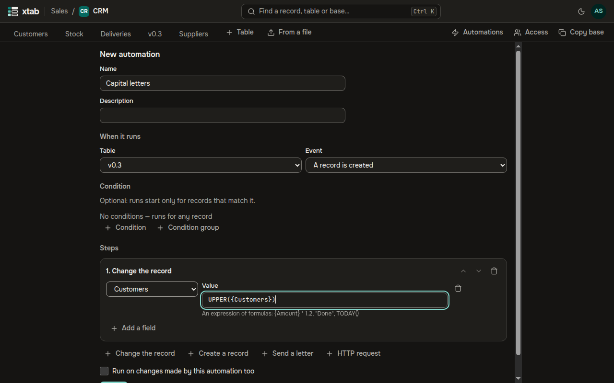
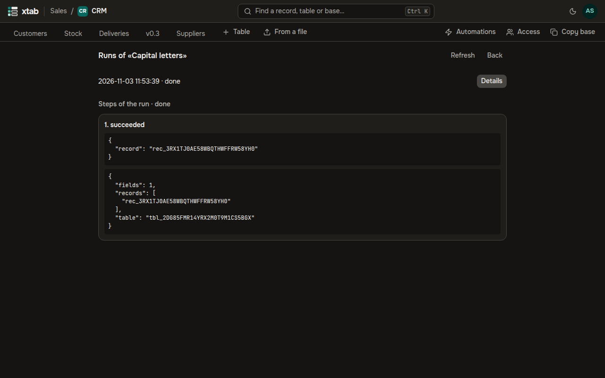

An automation does work by itself: when a record is created, changed, begins to match a condition or comes from a form, it does its steps — changes the record, creates a record in another table, sends a letter or an HTTP request to an external system. Creators of the base make and change automations; the steps run with the rights of the person who made the automation.

- **Open:** the button **Automations** in the row of tables of the base. The list shows each automation, its event, the number of its steps and its state: **On**, **Off** or **Stopped by the system** with the reason.
- **New automation:** give a name, the table and the event. For **A record is changed** tick the fields whose change starts it; for **A form is sent** pick the form. The **Condition** is built as the filter of a view; the event **A record begins to match the condition** needs one.

- **Steps** are added by the buttons under the list of steps and run in order; the arrows change the order, the bin removes a step.
  - **Change the record** and **Create a record**: pick a field and write its value as a formula, for example `UPPER({Name})` or `TODAY()`. A mistake in the formula shows under the field at once.
  - **Send a letter**: recipients from the e-mail and user fields of the record and addresses separated by commas, a subject and a text with inserts `{{ {Field} }}`. Letters go to members of the organization, to the domains of invitations and to the addresses the administrator allowed on the page **Outgoing addresses**.
  - **HTTP request**: the method, the address (its host is written without inserts and must be allowed on the page **Outgoing addresses**), headers, a JSON body with inserts, a signing secret and Basic authentication.
- **Secrets** are keys of external services and passwords for HTTP requests. They are set at the bottom of the form of a saved automation: a value is encrypted and never shown again, only replaced. In a header of a request choose the kind **Secret** and give the name of the secret.
- A new automation is off: click **Turn on**. When more than half of its last runs fail, or its owner no longer has the rights, the system turns it off and writes to the creators of the base.
- **Run log** shows the runs with the result of each step. A failed run can be **Run again**: the steps done are not repeated. When a letter or a request may have arrived but no answer came, the run's outcome is **outcome unknown**: check the receiver and click **Run again** or **Mark done**. The log keeps runs for 30 days.

