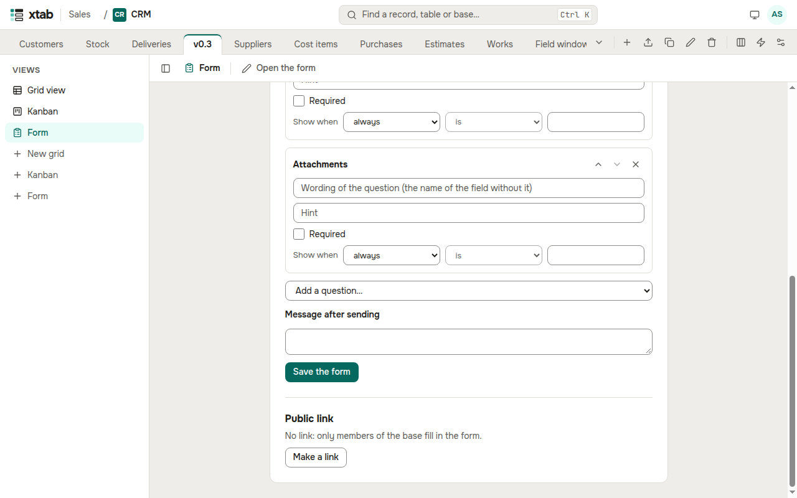
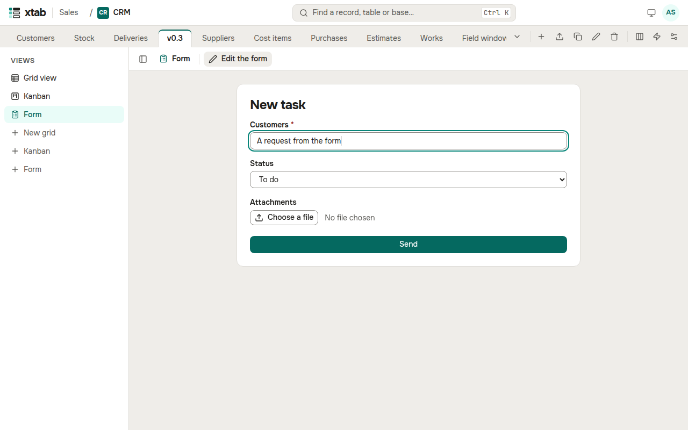
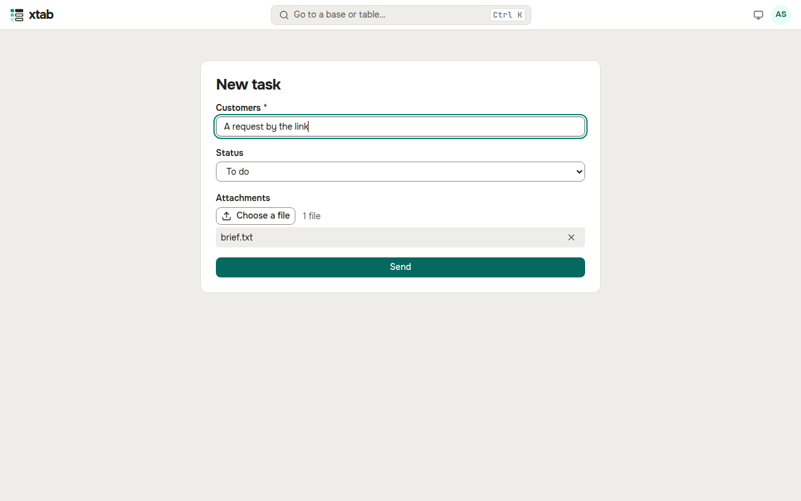

A form collects records into a table: the members of the base fill it in inside xtab, and anyone can fill it in by a public link without signing in.

- **Create:** click **+ Form** in the list of views on the left, type a name and press Enter; the builder opens.
- In the builder set the title, the description and the message after sending. **Add a question…** picks a field of the table. A question can have its own wording (without it the name of the field is shown), a hint, the mark **Required** and a condition **Show when**, so it appears only after a certain answer to an earlier question. **Up**, **Down** and **Remove the question** change the order and the set. Click **Save the form**.
- A form asks fields that are filled in by hand: texts, numbers, selects, checkbox, dates, files, users and links. A link is chosen among the records of the linked table with the condition of choosing of the field and the answers given so far. Formulas and system fields are not asked.

- **Open the form** fills it in yourself, **Edit the form** goes back to the builder. After sending, a message and the button **Send another** appear.
- If the questions of the form or the fields of the table change while the form is open — by you in another tab or by another person — the form shows the new questions at once, there is no need to reload the page. The answers to the questions left stay, the cursor stays in the same field, and **The form was changed** appears above the questions; the answer to a question taken away goes, and if files were chosen, the line asks to choose them again. If the form changes while it is being sent, the sending goes on, and the changed form shows how it ended — the message after sending or an error; the answers sent are not sent twice.

- **Public link** is in the builder. **Make a link**: the link is shown once, copy it right away. **Make a new link** replaces the old one, **Revoke the link** turns the form off for everyone who had it. The link is managed by whoever may change the views of the base.
- By the link the form is filled in without signing in. A public form has no questions about people or links; a question about files takes up to 5 files of up to 10 MB each. Before sending, the browser spends a few seconds proving the form is not filled in by a robot. If the check could not be prepared (no connection, an overloaded server), the form says it cannot take answers yet — press «Try again»; the answers typed are kept.

