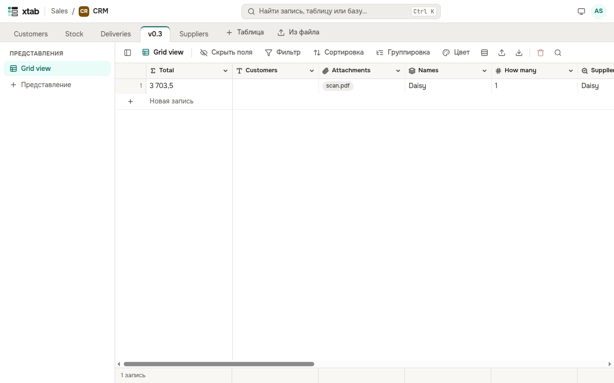

xtab speaks Russian and English. By default the language is that of the browser. To choose another, click the circle with your initials and choose **Language: English**, **Language: Русский** or **Language: as in the browser**. The choice is remembered in your account. Numbers and dates in a table are written as the chosen language writes them.

