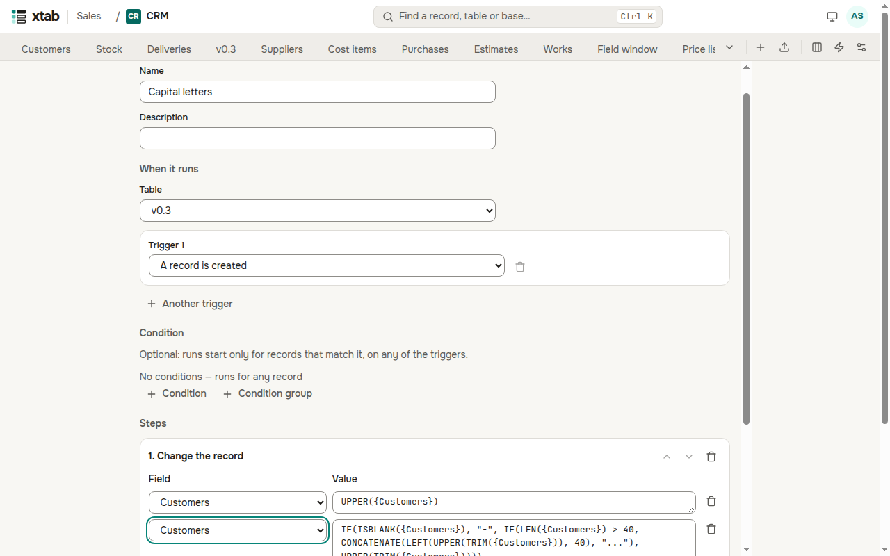
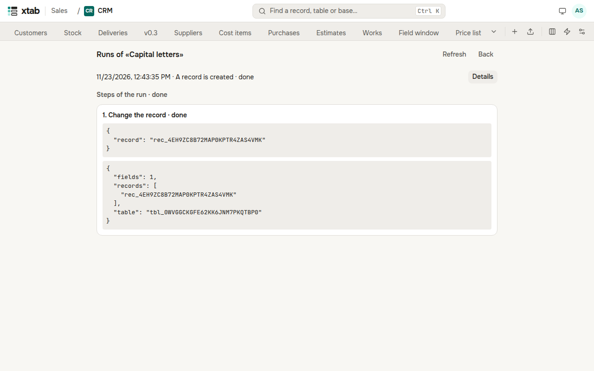

An automation does work by itself: on one trigger or several — a record is created, changed, begins to match a condition, comes from a form or a button of an interface is pressed — it does its steps: changes the record, creates a record in another table, sends a letter or an HTTP request to an external system. Creators of the base make and change automations; the steps run with the rights of the person who made the automation.

- **Open:** the button **Automations** in the row of tables of the base. The list shows each automation, its triggers, the number of its steps and its state: **On**, **Off** or **Stopped by the system** with the reason.
- **New automation:** give a name, the table and the trigger. For **A record is changed** tick the fields whose change starts it; for **A form is sent** pick the form; **A button of an interface is pressed** is started by a button of an interface with the action **Start an automation** that names this automation in its settings (see «Interfaces»). The **Condition** is built as the filter of a view; the trigger **A record begins to match the condition** needs one.
- **Several triggers:** the button **Another trigger** adds a trigger of another kind — five at most, one of each kind (the fields of **A record is changed** are ticked in one trigger); the bin by a trigger removes it, the last one cannot be removed. The automation starts on any of its triggers, and one change of a record starts it once, even when several triggers fit at once. The **Condition** is the same for every trigger. A step learns which trigger started the run by the function `TRIGGER()`: it gives `record_created` (a record is created), `record_updated` (a record is changed), `record_matches` (begins to match the condition), `form_submitted` (a form is sent) or `button_pressed` (a button is pressed).
  - **Example: created or changed** — looking up a company by its tax number is needed for a new record and when the number is edited: the triggers **A record is created** and **A record is changed** with the field **Tax number**, the steps — the request and **Change the record** of the examples below. To mark where the record came from: **Source** = `IF(TRIGGER() = "record_created", "new", "number edited")`.
  - When one of the triggers is **A form is sent**, the letters of the automation follow the rules of letters of a form whatever trigger started the run: without the tick **A run of a form may write outside the organization** they go to members of the organization only.

- **Steps** are added by the buttons under the list of steps and run in order; the arrows change the order, the bin removes a step.
  - **Change the record** and **Create a record**: pick a field and write its value as a formula, for example `UPPER({Name})` or `TODAY()`. A mistake in the formula shows under the field at once. A long value, address or text wraps at the width of the step, and its field grows in height up to 12 lines and scrolls past them, so the expression is seen whole; in a value of **Change the record** and **Create a record** Enter starts a new line.
  - **Send a letter**: recipients from the e-mail and user fields of the record and addresses separated by commas, a subject and a text with inserts `{{ {Field} }}`. Letters go to members of the organization, to the domains of invitations and to the addresses the administrator allowed in the part **Outgoing addresses** of the page **Policies**.
  - **HTTP request**: the method, the address, headers, the body, a signing secret and Basic authentication. In the address the host is written without inserts and must be allowed in the part **Outgoing addresses** of the page **Policies**; the path and parameters may hold inserts: `https://api.example.com/orders/{{ {Number} }}`.
  - **Body (JSON)**: a JSON text into which values of fields of the record go by inserts `{{ {Field} }}`. Write an insert inside the quotes of a JSON string: `{"query": "{{ {TIN} }}"}` — the value is escaped, so quotes and line breaks of the record do not break the JSON. The header `Content-Type: application/json` is added by itself unless you set your own.
  - **Example**: finding a company by its tax number in an external service — the method `POST`, the address of the service, the header `Authorization` of the kind **Secret** with the name of a secret, for example `api_key`, the body `{"query": "{{ {TIN} }}"}`; the host of the service in the part **Outgoing addresses** of the page **Policies**, the value of the secret `api_key` is `Token <key>` (see below).
  - **The answer of a request in the next steps**: a value of the answer is read by the function `STEP(number of the step, "path")` in the values of fields and in the inserts of the next steps: `STEP(1, "$.body.suggestions[0].value")` — the value at a path of the body of the answer of step 1 as a text, `STEP(1, "$.status")` — the status of the answer, `STEP(1, "$.error")` — the reason of a failure (empty when there is none). A path starts with `$.body`: keys after dots, an element of a list `[0]`, all elements `[*]`, a key with a space or not in Latin letters in quotes, `$.body."client name"`. Into a field «Number» write `VALUE(STEP(…))`, into a date `DATETIME_PARSE(STEP(…), "YYYY-MM-DD")`. When the answer has no such path the step fails with `#NOT_FOUND` and the path; to take it as a usual outcome wrap the value: `IFERROR(STEP(1, "$.body.suggestions[0].data.ogrn"), "")`. When you move or remove steps, the numbers in `STEP` are rewritten by themselves.
  - **Example: fill the fields by the tax number**: step 1 is the request of the example above, step 2 **Change the record**: **Name** = `STEP(1, "$.body.suggestions[0].value")`, **OGRN** = `STEP(1, "$.body.suggestions[0].data.ogrn")`, **Address** = `STEP(1, "$.body.suggestions[0].data.address.value")`.
  - **On error**: **Stop the run** (the default) or **Go on**. With **Go on** a failed request — a status other than 2xx, an answer that is not JSON, no answer after the retries — does not stop the run: the next steps run and learn of the failure from `STEP(1, "$.status")` (0 — no answer) and `STEP(1, "$.error")`. The reason `timeout` means no answer came in time: the request may have reached the receiver and been done there. So a record that could not be checked gets a mark: **Status** = `IF(STEP(1, "$.error") != "", "not checked", IF(ISERROR(STEP(1, "$.body.suggestions[0]")), "not found", "checked"))`, and the other fields `IFERROR(STEP(1, "$.body.suggestions[0].data.ogrn"), {OGRN})`, so a failure does not wipe the values they had. A mistake of the settings — a host not allowed, a secret not set — is not passed by **Go on**: the run stops.
- **Secrets** are keys of external services and passwords for HTTP requests. Do not type a key into a header of the kind **Text**: the text of a header is kept in the open in the automation, creators of the base see it, it stays in earlier versions of the automation and goes into copies of the base. The editor warns when a header looks like a key. If a key was saved as text before, replace it at the service and set the new one as a secret: the old one stays in earlier versions of the automation and in copies of the base.
  - In the header choose the kind **Secret** and give the name of the secret — Latin letters, digits, `_` and `-`, for example `api_key`. Do not type the key itself into the name: the name is kept in the open, and the editor warns when it looks like a key. Changing the kind empties the value.
  - Save the automation: secrets are set at the bottom of the form of a saved automation, under **Secrets**. Set a secret of the same name. The value of the secret is sent as the whole value of the header, so type it whole, with the word of the scheme: `Token 1a2b3c…` or `Bearer 1a2b3c…`. A value is encrypted and never shown again, only replaced. **Delete** at a secret asks first: once it is deleted, the runs that use the secret fail with «secret not set».
  - When the steps name a secret that is not set yet, the editor stays open after saving: «Saved. Secrets not set: …» appears by the buttons, the cursor moves to **Name** under **Secrets**, and the section names such secrets: a run without them ends with the error «secret not set». Type the name and the value and press **Set** or Enter — the secret appears in the list.
- A new automation is off: click **Turn on**. When more than half of its last runs fail, or its owner no longer has the rights, the system turns it off and writes to the creators of the base.
- **Duplicate**: the button in the row of an automation and in the editor of a saved automation makes its copy in the same table: named «<name> (copy)», the next copies «<name> (copy 2)», «(copy 3)» and so on (the first free number; a copy of a copy is numbered from the first name), with the same description, triggers, condition and steps. The copy is off, and you are its owner; the run log and earlier versions are not copied. The values of secrets are not copied: the steps name the same secrets, and you set their values again under **Secrets** — after duplication the editor of the copy opens and says under its heading which secrets to set. In the editor **Duplicate** does nothing while there are changes not saved: the copy is made of the saved automation. When a field or a form the automation names is deleted, no copy is made: the error at the row of the automation names the copy and the place, for example «Trigger 1 · Form».
- **Run log** shows the runs with the result of each step; **Details** opens the steps of a run under its row, and a second click hides them. For an HTTP request it shows the method, the address, the names of the headers, the code and the beginning of the answer (up to 4 KB, values of secrets cut out), and the values of the answer the next steps read (`values`); the body sent and the values of headers are not kept. A request with **Go on** that failed is marked failed with «the run went on», and the run goes on; such failures do not turn the automation off. The reason of a failure is said in words with the number of the step, for example «Step 3 · address not allowed by the policy «Outgoing addresses»: bu***@example.test» or «Step 1 · secret not set: api_key»; **Try on a record** names it the same way. The time of a run is shown by the clock of your computer, and by it the trigger that started the run. A failed run can be **Run again**: the steps done are not repeated. It runs by the same version of the automation it started with, so steps corrected since take no part — after correcting a step start the automation anew, for example by changing the record. Secrets are taken as they are now: after setting a forgotten secret click **Run again**. When a letter or a request may have arrived but no answer came, the run's outcome is **outcome unknown**: check the receiver and click **Run again** or **Mark done**. By default the log keeps runs for 30 days; the administrator of the organization sets the period in the part **Automations** of the page **Policies**.
- **Try on a record**: the button under the steps of the editor tries the automation before it is turned on, unsaved or off too. The field **Record** holds the first record of the table; to choose another, start typing a text of the record in it and choose the record in the drop-down list (by the arrows and Enter, or by a click), then click **Try**. HTTP requests are sent for real, while changes of records and letters are only shown: nothing is written or sent, and the run log gets no run. The course of the trial appears under the steps: for a request — the address, the headers (values of secrets as `***`), the body sent, the status and the answer (values of secrets cut out of it too); for **Change the record** and **Create a record** — a table «Field — Before — After» with the formulas recounted (a long value scrolls in its cell, JSON is shown with indents, an empty value is a dash); for a letter — the recipients, the subject and the text; for the steps that read an answer — the values of `STEP`. Above the steps it says whether the record meets the condition: the steps are tried either way. When the automation has several triggers, choose in **Trigger to try** which one the trial starts by: `TRIGGER()` gives it, the first trigger by default. Only a saved automation has secrets: save a new one and set its secrets before trying it. Only you see the result, for an hour; one trial runs at a time, at most ten a minute.

