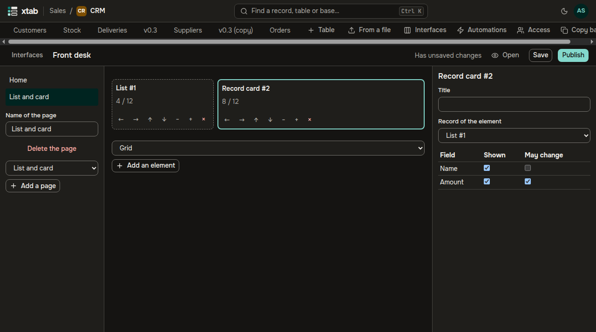
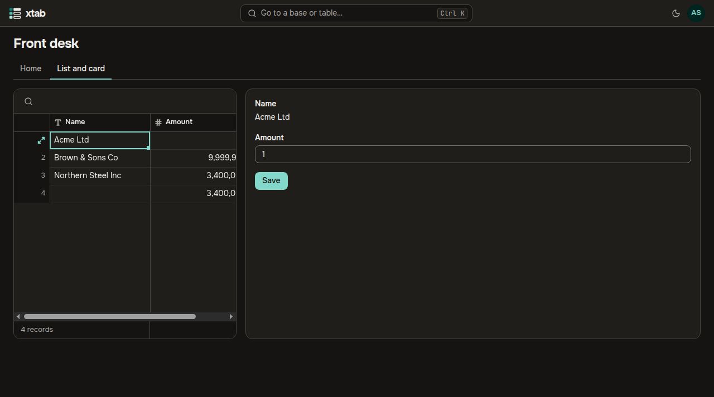

An interface is an app over a base: a few pages of ready elements through which people work with records without seeing the whole base. A creator of the base builds the interface in the builder and publishes it; the members of the base and those given the interface work in the published version.

- **Open the builder:** the button **Interfaces** in the row of tables of the base. The list shows the interfaces of the base and their state: **Not published**, **Has unpublished changes** or **Published**. Type a name and click **New interface**.
- **Pages** are on the left. Choose a layout and click **Add a page**: **List and card** — a list of records and the card of the chosen one, **Dashboard** — numbers and a grid, **Form** — the fields of a new record and the button **Send**, **Blank canvas** — an empty page. The name of the page changes in the field under the list.
- **Elements** stand in the cells of a grid of 12 columns. Choose a kind in the list under the grid and click **Add an element**. A cell can be dragged with the mouse before another cell, to the end of a row or between rows, where it becomes a row of its own. The buttons of a cell do the same from the keyboard: they move it left, right, up and down, make it narrower and wider, and remove the element.
- **Settings of the element** are on the right after a click on its cell: the title, the table, the fields with the flags **Shown** and **May change**, what may be done with records, the **Required filter** — its users neither see nor lift it — and the **Filters of the page** that narrow the element. A card has the element whose chosen record it shows; a number — what to count; a button — its action: **Create a record**, **Change the record**, **Open an address** or **Start an automation** with the event **A button is pressed**.

- **Save** writes the draft, **Publish** saves it and shows it to the users. Until the interface is published again, its users work in the previous version.
- **Open** shows the interface as its users see it: the pages are tabs on top. A record chosen in the list opens in the card; the fields the card lets change are changed there and written by **Save**. Changes of other people show up by themselves.

- **Access:** the button **Access** of an interface in the list gives it to a member of the organization or a group to **View** — read what the elements show — or to **Work** — also change, create and press buttons. Someone given the interface alone does not see the base and finds the interface in the section **Interfaces** on the start page.
- When a base is copied, its interfaces are copied unpublished and given to nobody.
