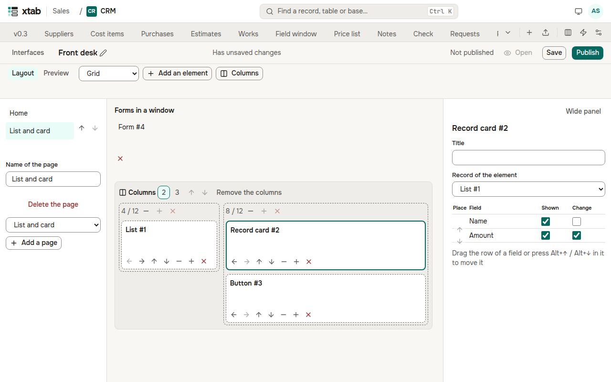
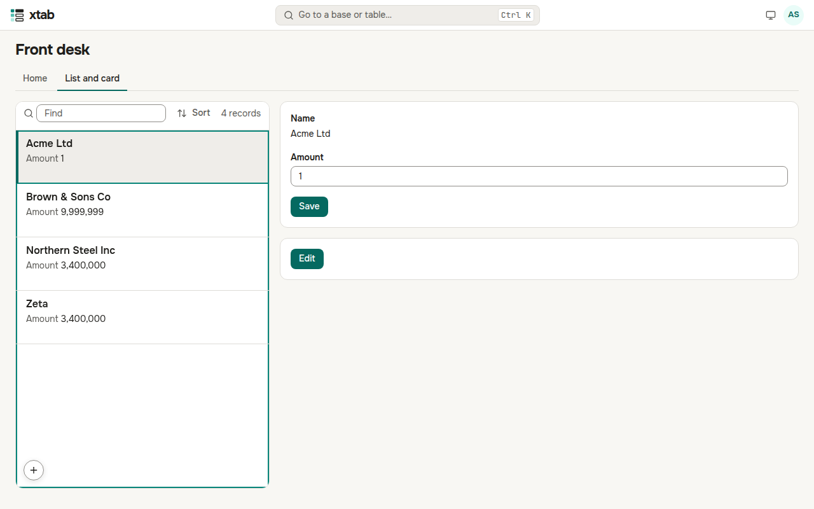

An interface is an app over a base: a few pages of ready elements through which people work with records without seeing the whole base. A creator of the base builds the interface in the builder and publishes it; the members of the base and those given the interface work in the published version.

- **Open the builder:** the button **Interfaces** in the row of tables of the base. The list shows the interfaces of the base and their state: **Not published**, **Has unpublished changes** or **Published**. Type a name and click **New interface**. The menu of an interface is the button with the sliders in its row (its hint is «Actions of the interface «…»»): **Rename the interface** opens the field of the name in place of the row (Enter saves, Escape cancels), **Delete the interface** asks to confirm.
- **The name and the description of the interface** change at once, without a publication. The name is in the bar of the builder: click it, or move to it with Tab and press Enter, type a new one and press Enter or move to another field; Escape cancels the change. The name cannot be empty: cleared, the field keeps the name of before and a note says so next to it. The description is in the **Settings of the interface** on the right while no element is chosen: it is saved when you leave the field.
- **Pages** are on the left. Choose a layout and click **Add a page**: **List and card** — a list of records on the left, the card of the chosen one with the button **Edit** under it on the right, **Dashboard** — numbers and a grid, **Form** — a form of a new record, **Blank canvas** — an empty page. A new page comes last. To move a page, drag it up or down the list, or reach it by Tab and press Alt+↑ and Alt+↓; the page open also has the arrow buttons **Up** and **Down** for it. The line under the list names the new place of the page; the users see the new order once it is published. The name of the page changes in the field under the list; it cannot be empty — cleared, the field keeps the name of before. Before **Delete the page** deletes a page with elements, the builder asks to confirm, naming the page and how many elements it has: the deletion cannot be undone; an empty page is deleted at once. In a window narrower than 1024 px — say, 1280 or 1440 px at 150 % — the pages open from the button **Page: …** above the canvas, and the canvas and the settings stand side by side; in a window narrower than 768 px the settings come under the canvas, and the whole builder scrolls: **To the settings** above the canvas leads to the settings of the chosen element, **To the canvas** at the top of the settings back to it.
- **Layout and preview:** above the canvas is the switch **Layout / Preview**. The **Preview** shows the page as its users will see it, with the real records of the base on your behalf — before it is published. A click on an element or on its label with its kind and number chooses it: its settings open on the right, and the buttons of a cell show on its frame; Escape lets it go. An element whose change is not saved yet is greyed out with the note "Updates after saving", a new one shows after saving. The data of the preview do not refresh by themselves — click **Refresh data**. The records in the preview are real: changes of cells and of the fields of a card and a new record are done at once, a deletion after a confirmation, and the buttons **Create a record**, **Change the record**, **Delete the record** and **Start an automation** and the sending of a form first ask "These are real data…". The kind of the canvas is remembered on this device.
- **Elements** stand in the cells of a grid of 12 columns. Choose a kind in the list above the canvas — next to the switch **Layout / Preview** — and click **Add an element**: the new element stands in a row of its own right under the row of the chosen element (under the whole row of columns when the chosen one is in a column), or at the end of the page when nothing is chosen; it becomes the chosen one, and the canvas scrolls to it. The list and the buttons stay in sight however far the canvas is scrolled. In the **Layout** a cell can be dragged with the mouse before another cell, to the end of a row or between rows, where it becomes a row of its own. The icon buttons of a cell (arrows, minus, plus and a cross; their hint names the action and the element, for example «Right: Grid #3») do the same from the keyboard: they move it left, right, up and down (an element alone in its row that does not fit into the next row swaps places with it; for an element alone in the top row **Up**, and in the bottom row **Down**, is unavailable: nowhere further), make it narrower and wider, and remove the element. A new **Filter** offers the first field of its table at once — tick the others in its settings; the last field of a filter or a form does not come off — tick another one first. A **Filter** removed simply stops narrowing the elements of the page. When you remove a grid, a list or a kanban that cards, buttons or forms take a record from, the builder names those elements and asks to confirm; after the removal choose their source in **Record of the element** again — until then the interface is not saved. When you remove a form that buttons open, the builder names them too: their action becomes **Create a record** (for a form of a new record) or **Change the record** — set their values.
- **Columns** group elements side by side: a row has 2 or 3 columns, each with its own elements top to bottom, and the height of a column does not depend on its neighbours (say, a grid on the left, a card with buttons under it on the right). The button **Columns** above the canvas adds a row of two empty columns of half the width each — where a new element would go; the button **Into columns** of a cell in the **Layout** turns its row of 1–3 cells into columns of the same widths. The head of a row of columns has the number of columns (**2** or **3**), the row moved up and down and **Remove the columns**: the elements are laid out in rows of cells again, nothing is removed. The head of a column has its width of 12 and the buttons **Narrower column**, **Wider column** (within the free room of the row) and **Remove the column** — its elements go to the neighbouring column. An element gets into a column by dragging or by its buttons: **Down** of a cell above a row of columns puts it at the top of the first column, **Up** of a cell under it — at the bottom; in a column **Up** and **Down** move the element along the column and, at its edge, out into the next row, **Left** and **Right** move it into the neighbouring column. After a move the line above the canvas names the new place of the element, for example "Column 2 of 3, place 1: Grid #3".
- **Settings of the element** are on the right after a click on its cell: the title, the table, the fields with the flags **Shown** and **May change** (ticking **May change** shows the field too, and unticking **Shown** unticks **May change**), what may be done with records, the **Required filter** — its users neither see nor lift it — and the **Filters of the page** that narrow the element. A card has the element whose chosen record it shows; a number — what to count; a button — its action: **Create a record**, **Change the record**, **Open an address** or **Start an automation** — an automation one of whose triggers is **A button of an interface is pressed**. A new card at once shows the records of an element of records on the page. When an element gets another table, or a card or a button another element whose record they take, the fields of the card are chosen again from the new table, and the values of **Change the record** and the automation of the button are cleared. The builder shows the fields of the tables as they are now — after changes in another tab of the browser too, when you come back to it; the editor of an automation — each time it is opened. A field deleted from its table shows in the builder as **Field deleted**. From the fields of an element, of the element **Filter** and the values of a button such fields are taken away on saving by themselves, while the field of the stacks of a kanban and the field a number counts must be chosen again — until then the interface is not saved. A condition of the **Required filter** on a deleted field is highlighted and shown as **Field deleted**, and a condition that does not fit the new type of its field — as **The operator does not fit the field**, and a condition with a value of the wrong form (say, a text for a number field) is only highlighted: remove or fix it — until then the interface is neither saved nor published. Nor is an element saved or published whose view filters by a deleted field or a field of another type: change and save the filter of the view in the table.
- **Width of the settings panel:** to make the panel wider or narrower, drag its left edge. From the keyboard, move to the edge with Tab and press the arrows (with Shift — by larger steps, Home and End — the narrowest and the widest). A double click on the edge brings back the usual width. Without dragging — the button **Wide panel** at the top of the panel makes it the widest, and a second press brings back the usual width. The width is remembered on this device for your account; other people do not see it. The panel is never narrower than the usual width nor wider than half the window; in a narrow window, where the builder is a single column, there is neither the edge nor the button **Wide panel**.

- **Create** and **Change** are separate actions. With **Change** a new record shows in the table at once and its fields are filled in in the cells. With **Create** but no **Change**, in a **Grid** the button **+**, the row **+** under the records and Shift+Enter open the **row of a new record** at the bottom: only the cells of the fields marked **May change** are filled in there, the others are grey — with the values of the required filter or empty. A hint in the bar above the grid tells the keys: F2, a character typed or a double click changes a cell (a checkbox — Space), Tab and Shift+Tab go to the next field to fill in, Enter creates the record, Escape cancels. The record is also created when you entered something and go to another row by an arrow or a click; going elsewhere on the page creates nothing. With nothing entered, Enter creates no record and asks to fill in a field; Shift+Enter creates the record and opens the next row at once. If the server refuses a value, its cell gets a red frame with an icon, and the line above the grid names the field and the reason. Files are not attached to a new record here. Once created, the record cannot be changed in the interface. In a **List** and a **Kanban** with **Create** but no **Change** the button **+** opens the dialog of a new record: fill in the fields and click **Create** (**Cancel** creates nothing). Pasting (Ctrl+V) adds no new records then. Records are deleted through an element — by the bin icon, in the menu of a selection or, in a **List** and a **Kanban**, in the dialog of a record — only when it may **Delete**; without that, undo (Ctrl+Z) does not delete a record just created either. When **Create** is on but no shown field is marked **May change**, the builder warns that records will be created empty.
- **No record window in a Grid.** A **Grid** has no window of a record with every field of the table: the number of a row, Space and the button of the editor of a long text open the record only when a form to open it in is chosen in the settings (**Open a record in a form**) — then that form opens, and the button of the editor reads **Open in the form**. A long text, links and files are changed right in the cell.
- **Order of the fields of a Grid, a List, a Kanban and a Record card.** In the table of the fields of the settings of the element the shown fields come first, in the order the users see them (in a **Grid** — the columns from left to right), and under the heading **Not shown** — the other fields of the table. To move a field, drag its row by the grip in the column **Place** or by its name, press the arrow button **Up** or **Down** — they come in place of the grip while the pointer is over the row of the field or the focus is in it (on a touch screen they are always shown) — or press Alt+↑ and Alt+↓ with the focus in the row of the field. The primary field, when shown, always comes first. A field whose **Shown** is ticked comes last among the shown ones, a field whose **Shown** is cleared goes to **Not shown**; the line under the table names the new place of the field. The users see the order once it is published and do not change it for themselves.
- **Widths of the columns of a Grid.** In the **Preview** drag the edge of the header of a column: the width is saved with the draft and works for every user once published. The same width is in the settings of the element, in the column **Width** next to each shown field: type a number of pixels from 60 to 600 (a number out of these limits is replaced by the nearest one, with a note under the field) or leave the field empty for the width by default, 180. A double click on the edge of a header in the preview gives back the width by default. Clearing **Shown** of a field clears its width too.
- **Sort of a Grid and a List.** In the settings of the element, in the section **Sort**, press **Add sort** and choose a field and a direction; up to three fields, and only the fields marked **Shown** are offered. This is the order of records for every user; without a sort, records go as in the chosen view or, without one, in the order of the rows of the table. A field whose **Shown** is cleared drops out of the sort. The **Preview** shows the order at once.
- **Change the order** is an action of a **Grid** and a **List**: with it, people with **Work** drag rows (in a **Grid** by the number of the row, in a **List** the row itself) and move the chosen record with Alt+↑ and Alt+↓. The menu of a row opens by the right mouse button, Shift+F10 or the context menu key, and in a **List** also by the button **Record actions** over it (handy on a touch screen): it has **Move up** and **Move down** and, when the element may also **Create**, **Insert record above** and **Insert record below** (in a **Grid** — when it may also **Change**). In a **List** the new record is filled in the window or the form of a new record and goes next to the chosen one; the window or the form says where it goes, and the button **To the end** there sends it to the end. Without **Change the order** a new record always goes at the end — by Shift+Enter in a **Grid** too. The order changes in the whole table — in all its views and interface elements. While the element has a sort, rows are not moved; the builder warns about it under the actions, and also when the view the element takes its records from is sorted.
- **Values of filters in a new record.** A new record in a table, list or kanban of an interface takes the values of the filters of the page — only in fields marked **May change** — and the values of the required filter of the element — in any field, marked or not. For example, with the required filter «Assignee is me» a new record gets you as its assignee at once and stays visible to you. Which conditions set a value — see «Filter».
- **List** — records as rows, not as the columns of a **Grid**: each row shows the main field large and up to four fields under it small, with their names (empty ones are left out). A list is for viewing and choosing a record: nothing is changed in its rows — records are changed by a **Form**, a **Record card** and buttons — and **May change** of a list marks the fields of the dialog of a new record. The settings of its own: **Main field** (by default — the primary one), **Fields under it** — by flags, up to 4, their order by the arrow buttons **Up** and **Down**, by Alt+↑ and Alt+↓ on the flag or the buttons of a chosen field or by dragging, and the line under the list names the new place of the field (none chosen — the first three shown fields after the main one in the order of the fields of the element), **Group by** — one of the shown fields, the order of the groups (for a link also **In record order** of the linked table) and the flag **Groups collapsed**.
- **Form** — an element to create, change and view one record. Its settings on the right start with the **Fields of the table** — a short list with a search (**Search fields**): each field has the mark of its type, its name and the mark **on the form** if it already stands on the form. Drag a field from the list onto the form on the canvas — it goes where you drop it — or press **+** in its row (**Add to the form**): the field goes at the end of the form. Below are the settings of the form itself: **What the form does** — **New record** (in the chosen table), **Edit the record** or **View the record** (the record chosen in the element of **Record of the element**); **Only in a window**, the **Description**, the **Button label** and the **Message after sending**.
- **The fields of a form are set on the canvas.** They lie on a grid of 4 columns as the users will see them; a narrow form has fewer (3, 2, 1), and a field wider than there are takes the whole row. A field is dragged by its head to another place, and its width is changed by pulling its right edge. A click on a field (in the **Preview** — on its name) opens its settings right under it: the **Kind** — **Editable**, **Required**, **Read-only**, and on a form of a new record also **Set by the form** — a value the form sets itself and the person does not change: a constant, for example `"New"`, or a formula over the record chosen in the element of **Record of the element** (until a value is written, the field keeps its kind); the **Width** of 1 to 4 columns, the **Label**, the **Hint**, **Show when** and **Remove from the form**. The settings of one field at a time are open; Escape or another click on the name closes them. In the **Preview** the fields of a form work as for its users, so the settings are opened by a click on the name of the field above its input. From the keyboard: Tab to the name of a field, Enter opens its settings; while the focus is on the name of a field or on its buttons, icon buttons are seen at the bottom of the field: arrows left and right (a place earlier or later), up and down (the row above or below), minus and plus (narrower or wider) and a cross (remove from the form); their hint and a screen reader name the action with the wording of the field, and the line above the canvas tells the new place of the field. Computed fields, files and every field of a view form are read-only. The values a form set in fields not on it (on pages saved before **Set by the form**) go at its end as **Set by the form** when the form is opened. A required field cannot be left empty — the form is not sent and shows what to fill in. Editing a record saves only what you changed; if another changed the record meanwhile, the form offers **Show the new values** or **Save mine over them**. A **Link** field is chosen among the records of the linked table by their names — in a **Grid** and a **Record card** too, where it is marked **May change**. Files are only shown in a form of an interface: they are not attached to a new record here.
- **Only in a window:** a form with this flag does not stand on the page; the builder shows it in the row **Forms in a window** above the grid, and in the **Layout** the fields of such a form, when it is chosen, are set under that row, in a frame of its own with its name. It is opened by a button with the action **Open a form** and by elements of records: **Open a record in a form** — a record opens in the form (in a grid — by the icon at the number of the row or by Space), **New record in a form** — the button **+** opens the form of a new record, and the record gets the values of the required filter of the element (for example, "Owner is me"). Escape and **Cancel** close the window, asking first when there are unsaved changes. The layout **List and card** at once puts the button **Edit** under the card, which opens the form of the chosen record. Both lists let you choose only the forms of the page that fit; the others are shown unavailable, with the reason — for example, "a new-record form: choose it in «New record in a form»". The buttons **Create an edit form** and **Create a new-record form** under the lists add a form **Only in a window** and choose it at once. When a form no longer fits — its mode or the table of the element changed, **Create** was unticked — the link to it is taken off by itself, and the draft is saved. A **Form** added to a page with a grid, a list or a kanban takes the table of that element, and an edit or view form without an element of records gets the first such element added to the page.
- **A new-record form follows the filters of its element.** When a form is opened by the button **+** of a grid, a list or a kanban with **New record in a form**, or stands on the page where that element adds its records, it takes the required filter of the element, the filter of its view and the filters of the page, so that the new record is sure to appear in that element. A field the filter leaves one value (for example, "Project is Alpha") is shown read-only with that value and the mark **Set by the filter** (a **Link** field — with the name of the record); when there are several values ("Project is any of Alpha, Beta"), only they stay in the list — in a **User** field too — and the field becomes required; "is not empty" makes a field required too. Under a number or a date with "greater", "less" or "between" its bound is written: the calendar of a date offers only the days that fit, and a number or a date past the bound is not sent — the form shows at once at the field what the filter allows. Under a field with a condition that cannot become a choice (for example, "contains") — "The record must match the filter of …". When a condition spans several fields with "or", this hint is shown once above the buttons. Values the filter requires to keep (for example, "Tags has all of Urgent") already stand in the field as chips without a cross and are taken off neither by the cross nor by Backspace; other values can be added. A linked record the filter requires to keep is not offered in the list. If a value still does not fit when the form is sent, the form creates no record and shows at the field what the filter allows (for example, "Allowed: Alpha, Beta" or "More than 100"). A value the form itself sets is marked **Set by the form**; a value the filter sets wins over it; the builder warns about it, about filters that contradict each other, and about fields with conditions of the filter that are not on the form. A form that changes a record is not limited by filters.
- **Buttons:** **Delete the record** deletes the record chosen in the element after a confirmation — if the element may **Delete**. A button that needs the chosen record is disabled until a record is chosen. The label of a button cannot be empty: erased, it keeps the label of before. A button **Create a record** without values creates an empty record — the builder warns about it; to let people fill in the fields, choose **Open a form**. Pages saved earlier with **Record fields** open as a form of a new record with the same button.
- **Text** — headings, paragraphs and lists. A line starting with «# » is a heading, with «## » a subheading, with «- » an item of a list; lines one after another stay one paragraph with their line breaks, and an empty line starts a new paragraph. The hint is under the field of the text in the settings of the element.

- **The draft saves itself** about a second after the last change; the bar of the builder shows "Saving…", "Saved at 12:34" or an error with its place — the page and the element; the frame of that element is highlighted. **Save** saves at once, **Publish** saves the draft and shows it to the users. When saving failed because of the network, **Publish** waits for it to be retried; when the draft could not be saved or published, the bar of the builder shows "Not published: …" with the reason. Until the interface is published again, its users work in the previous version. Closing the tab before the changes are saved, the browser warns. When the draft was saved meanwhile in another tab or by another creator of the base, the saving stops and the builder offers **Load the saved one** — your unsaved changes are lost — or **Save mine over it**.
- **Open** shows the interface as its users see it; before the first publication the button is inactive. The pages are tabs on top. The first row from the top with a grid, a list or a kanban stretches to the bottom of the window, and the elements under it go to its lower edge; in a row of columns only the columns with a grid, a list or a kanban stretch, the others keep the height of what they show; the table never gets lower than its usual height — with many elements the page scrolls. A record chosen in the list opens in the card; the fields the card lets change are changed there and written by **Save**. Changes of other people show up by themselves. On a narrow screen the columns stand one under another in their order: the whole first column, then the second. When the table was changed so that the filter of an element names a deleted field or a field of another type, the element says "The element is outdated…" — tell the creator of the base.
- **Widths of columns for yourself:** in a published **Grid** drag the edge of the header of a column. The width is kept on this device for your account, this interface and this grid, and stays after a reload; other users do not see it. A double click on the edge gives back the width the creator of the interface set. The order of the columns does not change in an interface.
- **Sort for yourself:** the button **Sort** over a **Grid** or a **List** opens a panel: **Add sort**, a field and a direction, up to three fields. Only you see your order: it is kept on this device for your account, this interface and this element and stays after a reload, and the button is coloured. Without it the panel names the default order set by the creator. **Reset** gives the creator's order back. In a **Grid** the header of a sorted column shows an arrow of the direction. While a sort applies, rows are not dragged: a try shows a hint over the element.
- **Working with a list:** a click on a row, Enter or Space chooses the record — the row is marked by a stripe on the left, and if the list has **Open a record in a form**, the record opens in the form at once. The arrows ↑ and ↓ go from row to row, PageUp and PageDown by a screen, Home and End to the first and the last record. Above the list are the search among the shown fields and the number of records; the trash button and the Delete key delete the chosen record after a confirmation, if the list may **Delete**. In a grouped list a click on the header of a group or the keys ← and → collapse and expand the group of the active row. The button **+** at the bottom opens the dialog of a new record or the form of a new record.

- **Access:** the button **Access** of an interface in the list gives it to a member of the organization or a group to **View** — read what the elements show — or to **Work** — also change, create and press buttons. At **View** a form of editing shows its record without changes, and a form of a new record has no button and the note "No right to create records". Someone given the interface alone does not see the base and finds the interface in the section **Interfaces** on the start page.
- When a base is copied, its interfaces are copied unpublished and given to nobody.
