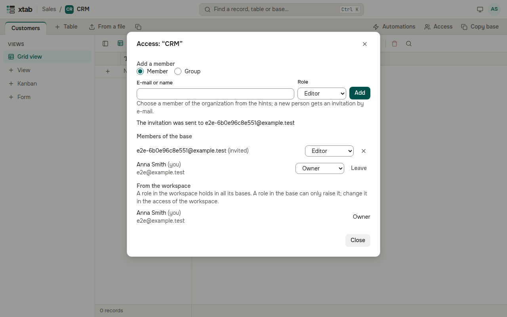
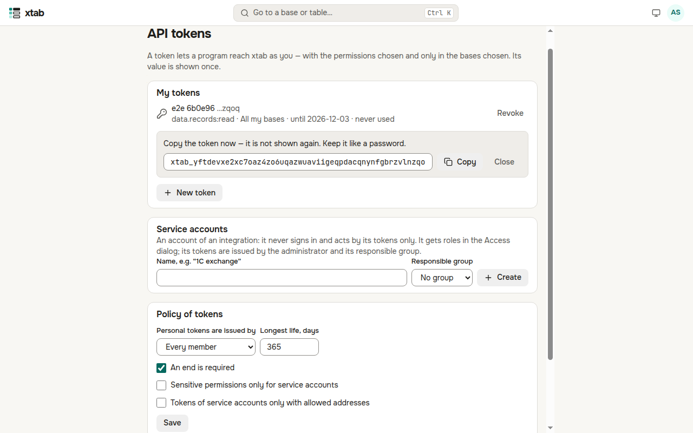
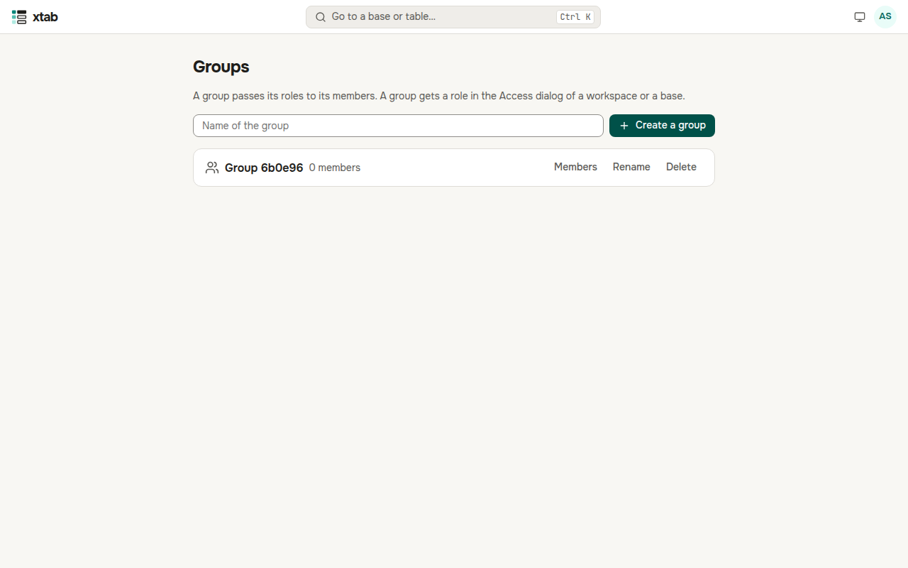

Changes by other people appear in your table by themselves, without reloading the page: new and deleted records, edits of cells, new fields.

## Access to a workspace and a base

Who works in a base is shown by the **Access** button at the end of the row of table tabs; a workspace has the same button in its heading on the start page.

- The dialog lists the members with their roles: a **Reader** sees the data, a **Commenter** also comments, an **Editor** changes records, a **Creator** changes tables, fields and views, an **Owner** manages everything, access included.
- A role in the workspace holds in all its bases. The dialog of a base shows such members apart — “From the workspace”; a role in the base can only raise it.
- To add a person, enter their e-mail or name, choose a role and press **Add**. A member of the organization can be picked from the hints — the role appears at once; a new person gets an invitation by e-mail.
- A role is changed in the list next to the person; the cross removes access. A creator gives roles up to Editor, an owner any role. The last owner cannot be removed.
- The **Leave** button on your own row removes your own access.
- A role can be given to a group too: choose **Group** in the form, then the group and the role. Every member of the group gets the role.

## API tokens

A token lets a program (a 1C exchange, a BI report) reach xtab as you. **Account menu → API tokens**.

- **New token**: enter what it is for, tick the permissions (sensitive ones are marked), choose all your bases or only some, the life and, if needed, the addresses it may be used from. xtab asks for your password.
- The value of the token is shown once — press **Copy** and keep it like a password. Afterwards only its last four characters are shown.
- **Revoke** switches the token off at once.
- **Service accounts** are for integrations that must not depend on an employee. The administrator creates them, they get roles in the Access dialog, and their tokens are issued by the administrator and the members of the responsible group.

- The administrator of the organization sets the policy of tokens here too (who issues them, the longest life, limits) and sees every token of the organization.

## Groups

The administrator of the organization keeps groups: **account menu → Groups**.

- Enter a name and press **Create a group**.
- **Members** opens who is in the group: add a person by e-mail or name, the cross takes them out. If you add yourself to a group that has roles, xtab asks for your password.
- **Rename** and **Delete** are on each group. Deleting a group also removes the access it gave.

