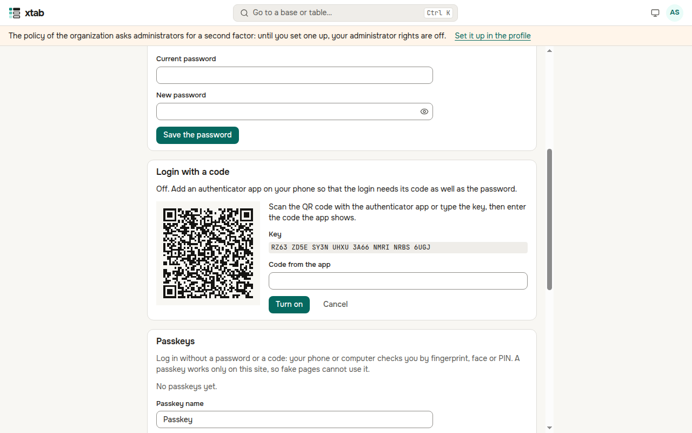
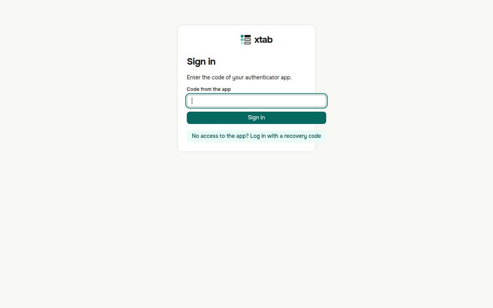
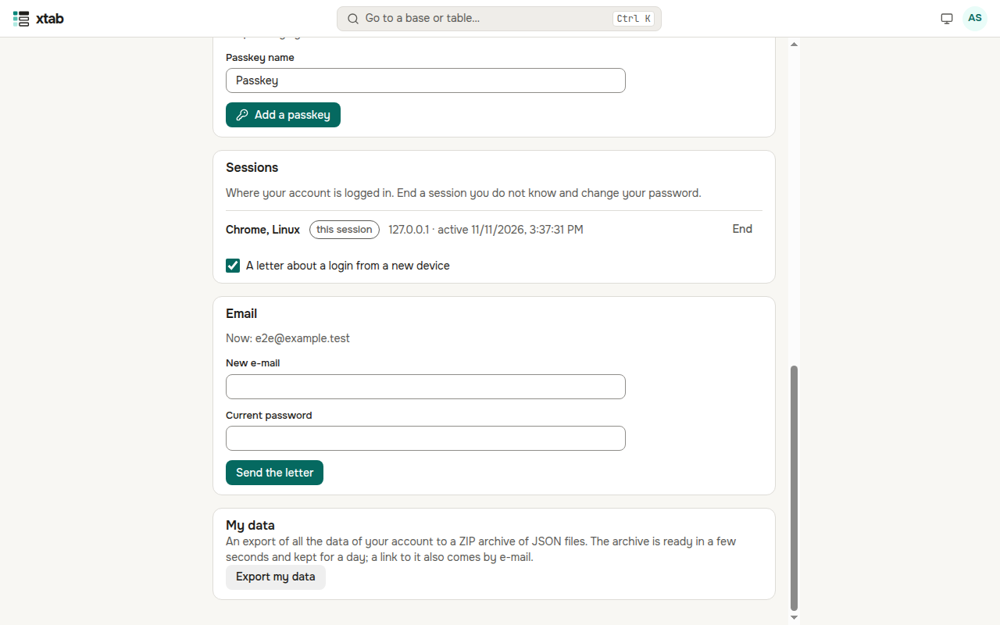
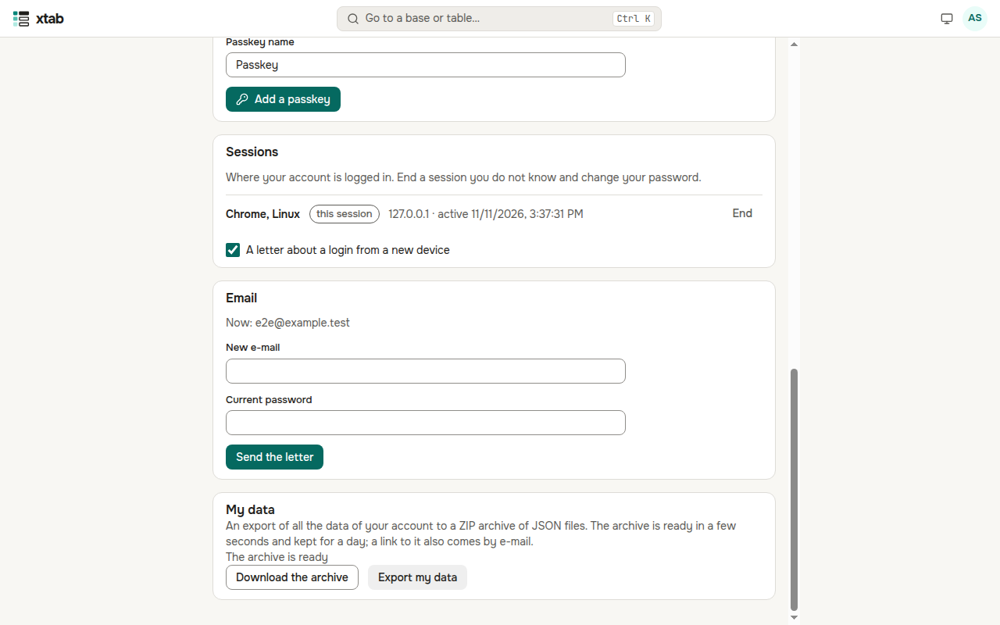

You set up your own account in the profile: **the circle with your initials → Profile**.

## Profile

- **Photo**: JPEG, PNG or WebP up to 1 MB; every member of the organization sees it. **Remove the photo** brings the initials back.
- **Name** and the **time zone** dates are shown in — press **Save**.
- **Password**: enter the current one and the new one. Your other sessions end when it changes.
- **E-mail**: enter the new address and your password and press **Send the letter**. The address changes when you open the link of the letter; the old address gets a notice.

## Login with a code

A second factor protects the account even if the password is known to someone else. Administrators of the organization usually must have one: until it is set up, their administrator rights do not work and a warning is shown at the top of the page.

1. In **Login with a code**, press **Add an app** (xtab asks for your password).
2. Scan the QR code with an authenticator app on your phone (Google Authenticator, Yandex Key and others) or type the key in by hand.
3. Enter the code from the app and press **Turn on**.
4. Keep the **recovery codes** in a safe place — they are shown only once. Each code works once when the phone is not at hand.

From now on xtab asks for a code from the app after the password. No access to the app — press **No access to the app? Log in with a recovery code**.

**Passkeys** log you in without a password and a code: the phone or the computer checks your fingerprint, face or PIN. Press **Add a passkey** and follow the browser; the login page gets the button **Log in with a passkey**.

## Login through a provider

If the organization connected its corporate login (Active Directory, Keycloak and others), the login page has a button **Log in with …**. To log in this way to an account you already have, press **Bind** in **Login through a provider** of the profile and log in at the provider. **Unbind** removes the binding; the last way to log in cannot be unbound.

## Sessions

**Sessions** shows where your account is logged in: the browser, the system, the address and when the session was last active; the current one is marked "this session". End a session you do not know with **End** and change your password. **End all others** keeps only the current one.

## My data

Press **Export my data** (xtab asks for your password): in a few seconds a ZIP archive is ready with your profile, groups and roles, sessions, API tokens without their values and the audit events about you. Press **Download the archive**; when the organization has mail set up, a link to the archive also comes by e-mail. The archive is kept for a day.

