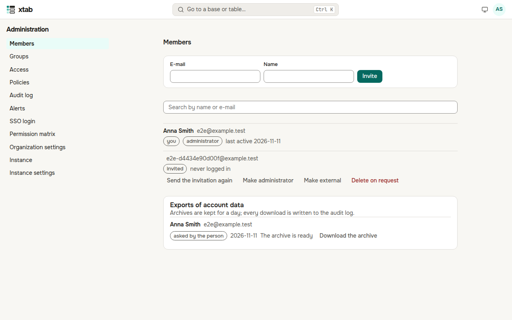
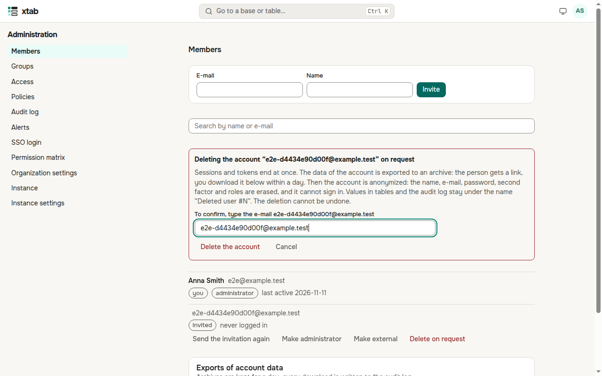
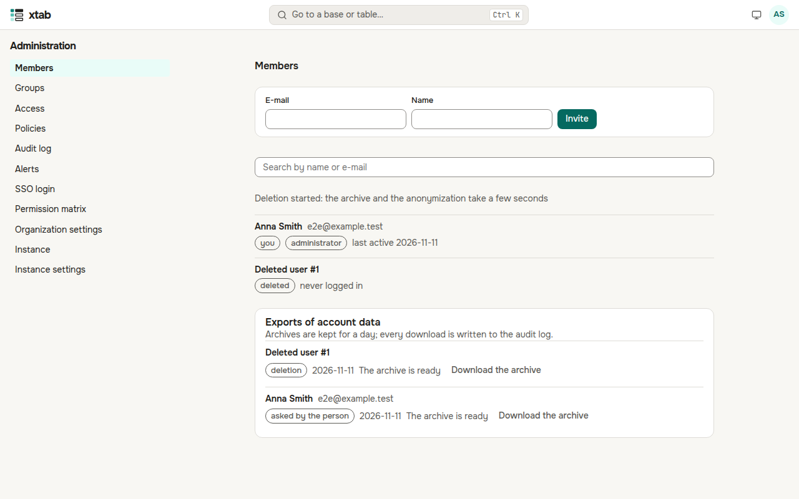
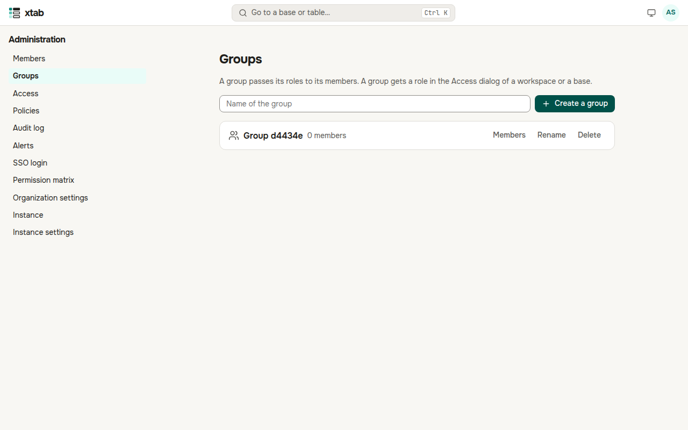
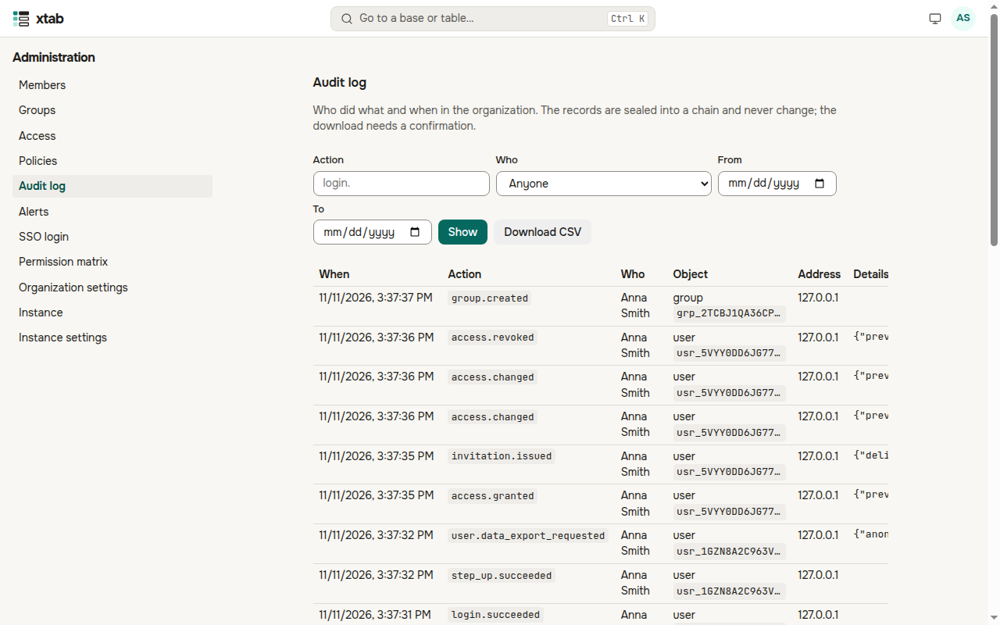
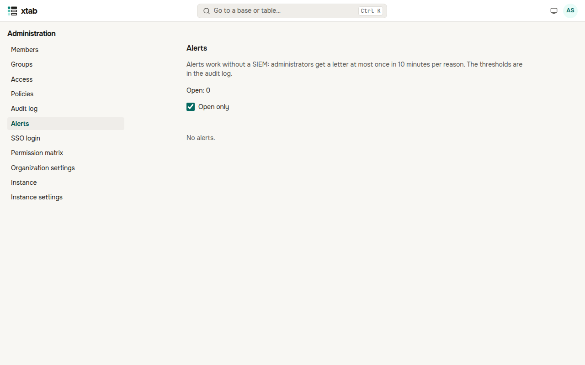
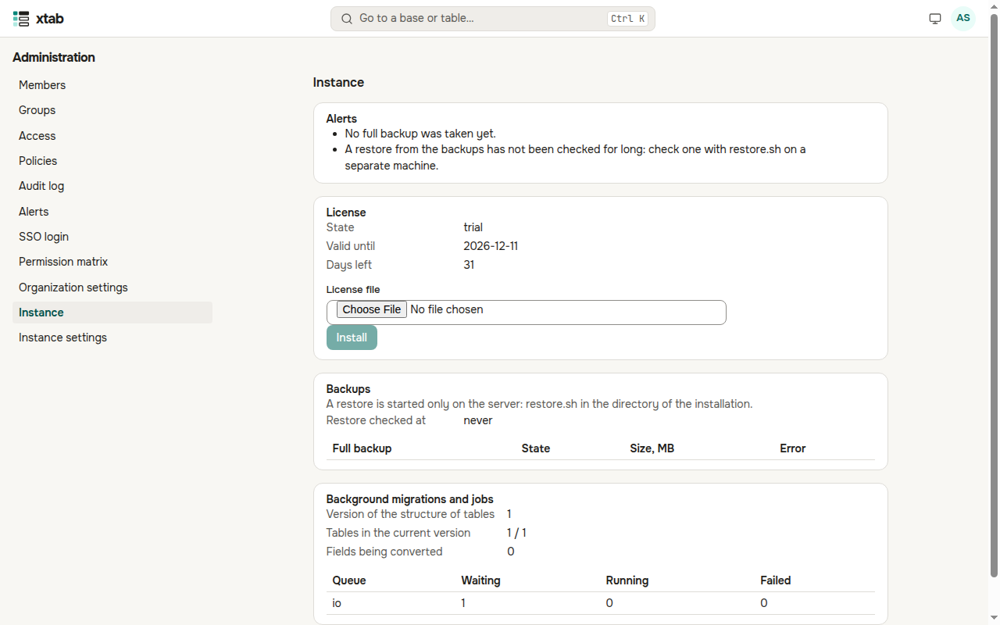
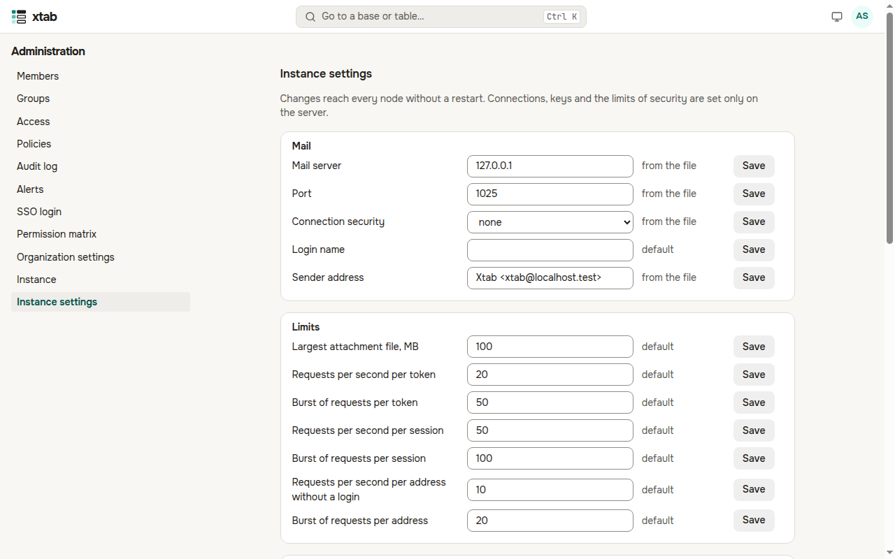

The administrator of the organization manages it in **Administration** of the account menu. The data of bases stays closed to the administrator until they have a role (see Access below). Actions that change security ask for the password.

## Members

- **Invite**: enter the e-mail and the name — the person gets an invitation. Search the list by name or e-mail.
- Each member shows whether they are an administrator, whether they have a second factor, whether their password login is locked after wrong passwords, and when they were last active.
- The buttons of a member: **Block** / **Unblock** (a block ends their sessions and tokens at once), **Make administrator** / **Remove administrator**, **End sessions and revoke tokens** (e.g. after a lost laptop), **Reset second factor** (when the person lost the phone and the codes), **Unlock login**, **Send the invitation again**.

**External members** are marked "external". An external member sees in the lists of people only themselves and those who share workspaces and bases with them, creates no workspaces and invites nobody. xtab sets the mark when an administrator invites a person outside the domains of the organization; an administrator sets it with **Make external** and clears it with **Clear «external»**.

**Deletion on the request of the person.** Press **Delete on request**, type the e-mail of the account and press **Delete the account** (xtab asks for your password). The sessions and tokens of the person end at once. In a few seconds:

- the data of the account is exported to an archive — the person gets a link to it by e-mail (when mail is set up), and you download it in **Exports of account data** below (the archive is kept for a day, every download is written to the audit log);
- the account is anonymized: the name, the e-mail, the password, the second factor, the roles and the groups are erased, nobody can log in to it, and its e-mail can be invited again;
- values in tables and the audit log stay under the name "Deleted user #N".

A deletion cannot be undone. You cannot delete yourself — another administrator does it.

## Groups

- Enter a name and press **Create a group**.
- **Members** opens who is in the group: add a person by e-mail or name, the cross takes them out. If you add yourself to a group that has roles, xtab asks for your password.
- **Rename** and **Delete** are on each group. Deleting a group also removes the access it gave.
- A group can follow a group of the login provider (see SSO login): its members are then updated at every login.

## Access

Every workspace and base of the organization with the roles of people and groups. When a base has no owner left, or you need to work with its data, press **Give myself** and choose a role — the owners get a letter and the audit log records it. **Make owner** hands a base over to another person.

## Policies

- **Passwords and the lockout**: the length and the make-up of a password, no reuse of old ones, how long it works, the lockout after wrong attempts. A new password is also checked against a list of breached ones.
- **Second factor of administrators**: whether administrators (or everyone) must have one, and whether only a passkey counts.
- **Public links**: whether public links to forms are allowed.
- **Outgoing addresses**: where automations may send requests and letters (see Outgoing addresses).

The policy of API tokens is set on the page of API tokens.

## SSO login

The OpenID Connect providers of the organization: **Add a provider**, enter the name of the login button, the issuer, the client id and its secret. Register the **redirect address** and the **logout address** shown on the page at the provider. **Check** makes sure the provider answers. Below are the groups of the organization that follow groups of the provider, and the lifetime of a session opened through a provider.

## Audit log

Who did what and when in the organization: logins, changes of rights and policies, exports, actions of administrators. Choose events by action, person and time and press **Show**; **Download CSV** saves what is chosen (xtab asks for the password; the download is in the log too).

The records are sealed into a chain: each is tied to the previous one, the checkpoints are signed. **Chain of seals** shows the last seal and the last check — if a record was changed or deleted in the database, the check finds it and an alert comes. Here are also how long the log stays in the database (older months go to the archive), the thresholds of the alerts and the delivery to SIEM.

## Alerts

Without a separate monitoring system xtab itself tells about suspicious events: an administrator gave themselves access, a mass export, a token from a new network, a spike of denied access, mass lockouts of accounts, a reset of the second factor of an administrator, the mandatory second factor turned off, a broken chain of the log. The administrators get a letter; mark what you handled with **Handled** in the feed.

## Permission matrix and settings

**Permission matrix** shows what each role may do in the installed version. **Organization settings** hold the name, the time zone and the language of the organization; a new time zone or language recounts the formulas with dates and texts, and the page shows how far it got.

## Instance

The **Instance** tab of Administration is shown to the administrator of the whole xtab installation (the administrator of the server makes one) and opens only with a second factor connected.

- **Alerts** — what needs attention: the term of the license, a full backup not taken for long, a restore not checked, background jobs that failed.
- **License** — its state (trial, valid, grace period, read-only), term and quotas. Install the license file from the supplier with **Install**; the nodes apply it within 5 minutes.
- **Backups** — the last full backups and segments of the database log, when a restore was last checked and how long it took.
- **Background migrations and jobs** — changes of field types and the queue of background jobs.

**Instance settings** — mail, limits, logs, rules of login and passwords, backups. Changes apply on all nodes without a restart; **Reset** returns the value of the server's settings or the default.

**The license for everyone.** Shortly before the license or the trial ends, a warning shows above the page. When the term and the grace period are over, the data stays available for reading and export, but not for changes, until an administrator installs a new license.
