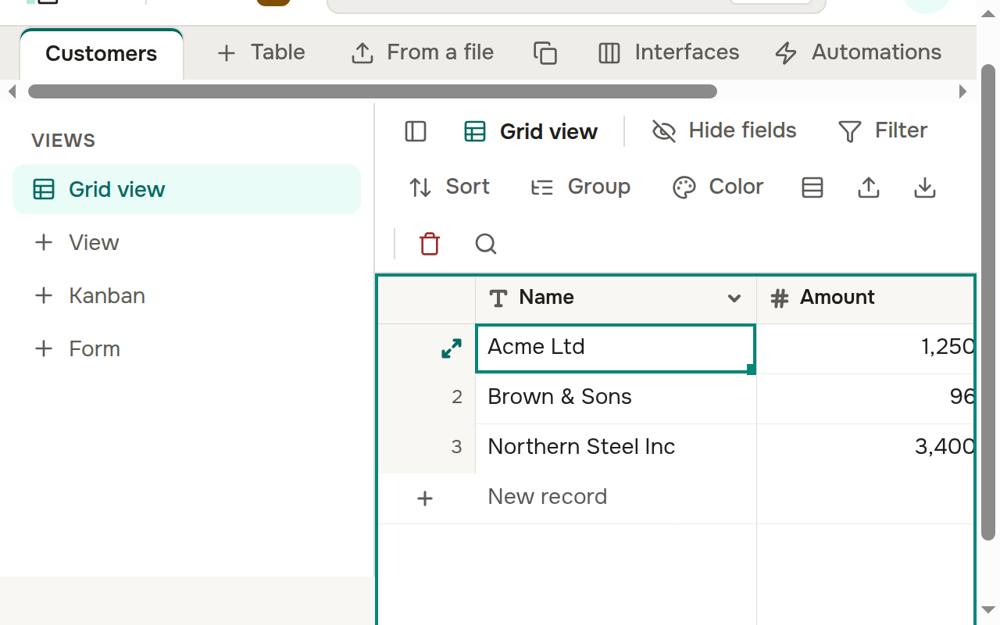

- **Screen readers** (NVDA, Orca): moving through a table with the arrows, the reader names the field, the value and the number of the row, for example "Amount: 1,250,000, row 3".
- **Large text and zoom:** the table follows the font size in the settings of the browser and a zoom of the page up to 200 % — rows, columns and the cell editor grow with the text.
- Working with a table from the keyboard — see "Selecting, copying and pasting" and "An expanded record".

