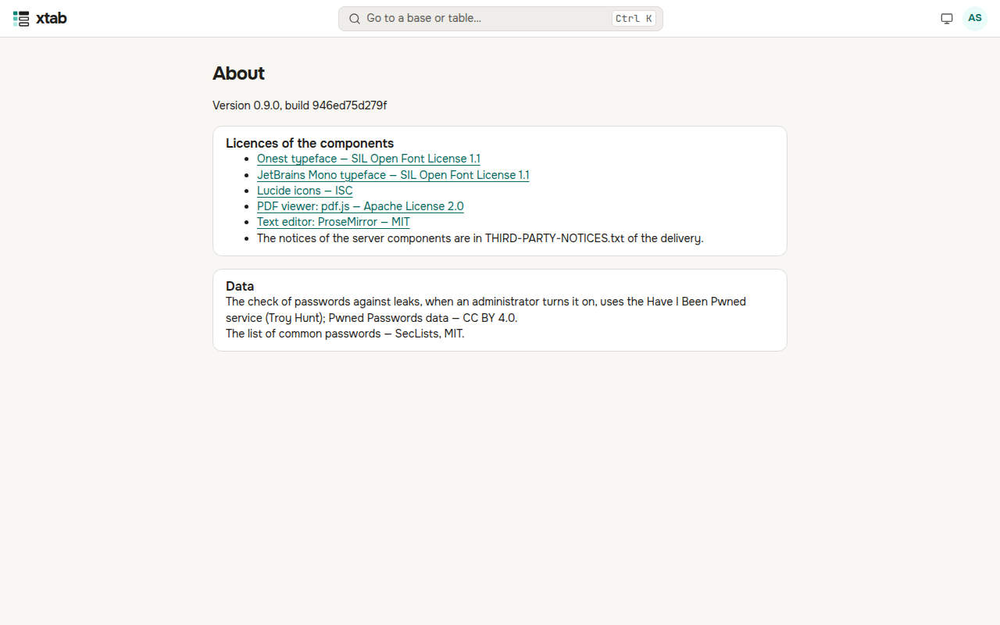

The menu of the account → **About** (on the sign-in page — a link at the bottom): the version and build of xtab, the licenses of the built-in components, fonts and icons. When you are not signed in, the bottom of the page has the link **Back to sign in**.

