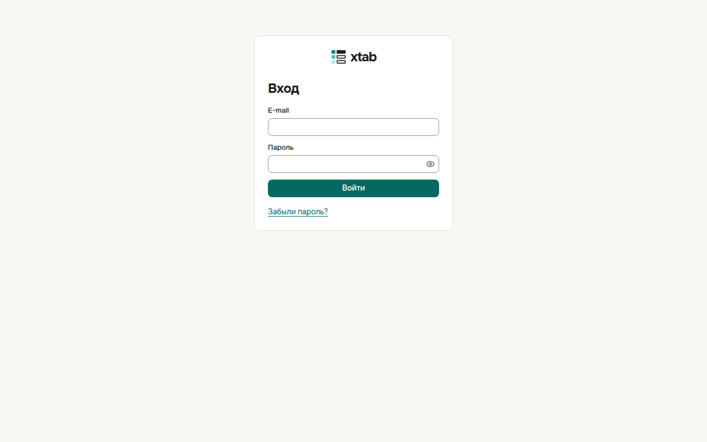

Первое письмо от xtab — приглашение со ссылкой. Откройте ссылку, укажите своё имя и придумайте пароль не короче 12 символов, затем нажмите **Присоединиться**. Ссылка действует один раз.

В следующий раз откройте адрес xtab, введите e-mail и пароль и нажмите **Войти**. Чтобы проверить, правильно ли набран пароль, нажмите значок глаза справа в поле пароля — пароль станет виден, повторное нажатие снова его скроет.

Если пароль забыт, нажмите **Забыли пароль?**, введите e-mail и нажмите **Отправить ссылку**. По ссылке из письма задайте новый пароль.

Чтобы выйти, нажмите на кружок с инициалами в правом верхнем углу и выберите **Выйти**.
