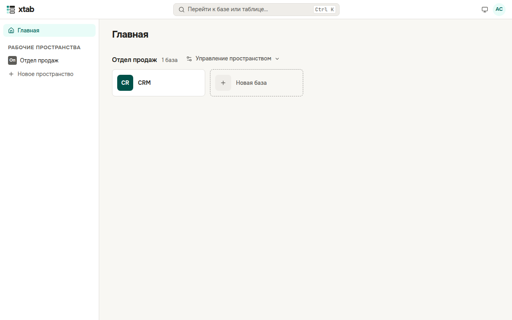

После входа открывается главная. Слева — рабочие пространства: в них собраны базы одного отдела или направления. Справа — базы каждого пространства плитками. На телефоне список пространств стоит под плитками баз.

- **Новое рабочее пространство:** слева нажмите **Новое пространство**, введите название и нажмите Enter.
- **Новая база:** в нужном пространстве нажмите плитку **Новая база**, введите название и нажмите Enter. База откроется сразу.
- **Открыть базу:** нажмите на её плитку.
- **Перейти к пространству:** нажмите на него в списке слева.
- **Копия пространства** (для владельца пространства): нажмите **Управление пространством** рядом с его названием и выберите **Копировать пространство**, при желании измените название и нажмите **Копировать**. Копия получит все базы пространства с данными; её владелец — вы, участники исходного пространства в копию не переходят.
- **Переименовать или удалить пространство** (для его владельца): **Управление пространством** → **Переименовать пространство** — новое название и **Сохранить**; **Удалить пространство** — вместе со всеми его базами, xtab спросит подтверждение.
- В меню **Управление пространством** видны только разрешённые вам действия: **Доступ** — создателю и владельцу пространства, остальное — владельцу. Читатель, комментатор и редактор вместо меню видят кнопку **Участники**.
