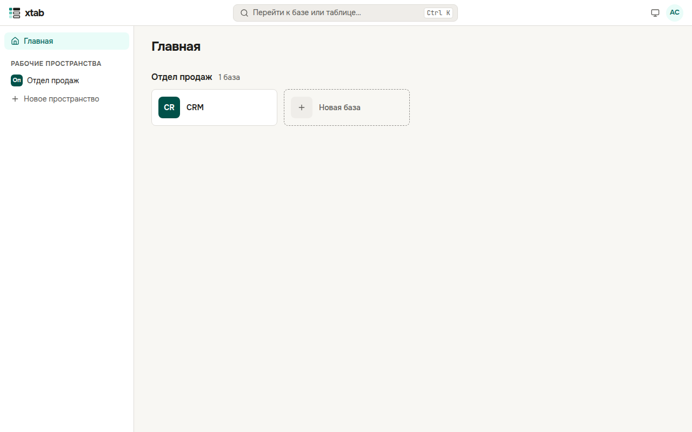

После входа открывается главная. Слева — рабочие пространства: в них собраны базы одного отдела или направления. Справа — базы каждого пространства плитками.

- **Новое рабочее пространство:** слева нажмите **Новое пространство**, введите название и нажмите Enter.
- **Новая база:** в нужном пространстве нажмите плитку **Новая база**, введите название и нажмите Enter. База откроется сразу.
- **Открыть базу:** нажмите на её плитку.
- **Перейти к пространству:** нажмите на него в списке слева.
