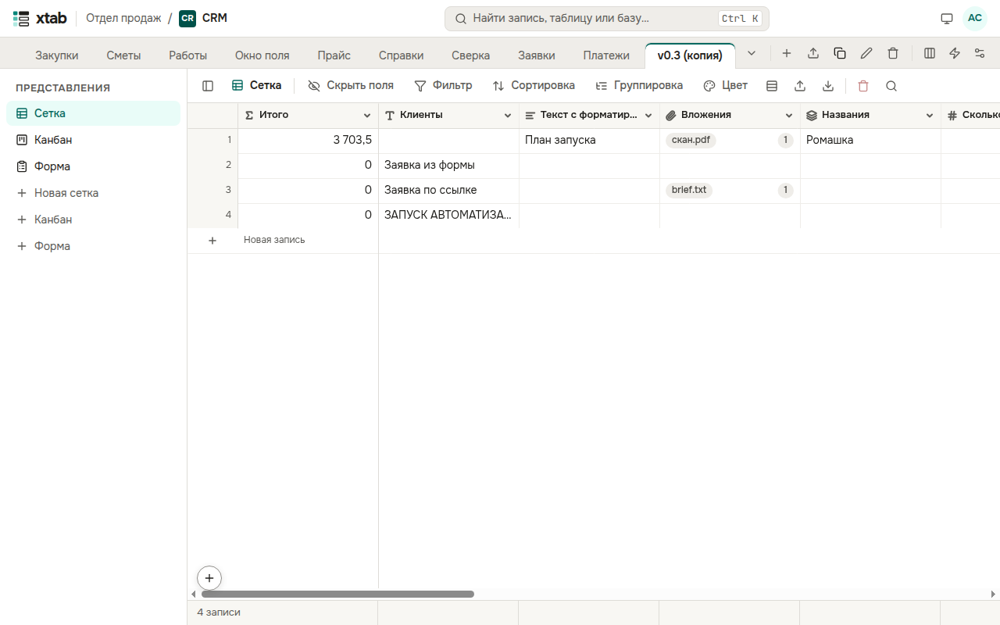

Таблицы базы — вкладки под верхней строкой. Открывается таблица, которую вы открывали в этой базе последней, а если её уже нет — первая таблица, вкладку которой вы не скрыли.

Длинное название на вкладке обрезается многоточием, полностью оно видно во всплывающей подсказке. Если вкладки не помещаются, прокручивается только их ряд — колесом мыши, жестом или клавишей Tab: кнопки сразу после вкладок, а также **Интерфейсы**, **Автоматизации** и **Управление базой** у правого края остаются на месте. Когда строке вкладок не хватает места для подписей кнопок — окно уже, увеличен масштаб или шрифт, — все кнопки строки, в том числе **+ Таблица** и **Из файла**, показываются значками, а их названия — во всплывающей подсказке; строка остаётся одной линией. На телефоне вкладки занимают первую строку, а кнопки — вторую.

- **Новая таблица:** нажмите **+ Таблица** справа от вкладок, введите название и нажмите Enter. В новой таблице уже есть поле «Название».
- **Таблица из файла CSV или Excel:** нажмите **Из файла** справа от вкладок — см. раздел «Импорт из CSV и Excel».
- **Другая таблица:** нажмите на её вкладку.
- **Порядок вкладок:** перетащите вкладку на новое место — черта покажет, куда она встанет. С клавиатуры: перейдите на вкладку клавишей Tab и нажимайте Alt+← или Alt+→. Порядок общий для всех участников базы и сразу меняется у них; его же показывает список **Все таблицы**. Менять порядок могут создатель и владелец базы. Новая таблица и копия встают в конец.
- **Все таблицы:** если таблиц много, нажмите стрелку **Все таблицы** сразу после вкладок. Откроется список всех таблиц базы с поиском по названию: щелчок или Enter открывает таблицу.
- **Скрыть вкладку у себя:** в списке **Все таблицы** нажмите значок глаза у таблицы. Вкладка пропадёт только у вас — у других она видна как прежде. Таблица остаётся в списке **Все таблицы** с пометкой «скрыта» и в быстром переходе Ctrl+K, а пока она открыта, её вкладка видна. Вернуть вкладку — тем же значком. Скрытие меняет только вид строки вкладок и не ограничивает доступ к таблице.
- **Копия таблицы:** откройте таблицу и нажмите значок копирования справа от **Из файла**, при желании измените название и нажмите **Копировать**. Копия появится новой вкладкой: те же поля, записи, файлы и общие представления. Если таблица связана с другой, в той появится встречное поле с названием копии.
- **Копия базы:** в конце строки вкладок нажмите **Управление базой** и выберите **Копировать базу**. Копия откроется сразу: все таблицы, связи между ними, представления и автоматизации. Автоматизации в копии выключены и без секретов — включите их и задайте секреты заново, когда будете готовы.
- **Переименовать или удалить таблицу:** откройте её и нажмите значок карандаша или корзины рядом со значком копирования. Удаление убирает таблицу со всеми записями, xtab спросит подтверждение.
- **Переименовать или удалить базу:** **Управление базой** → **Переименовать базу** или **Удалить базу**. Удалённая база исчезает вместе с таблицами, интерфейсами и автоматизациями, а вы возвращаетесь на главную.
- В меню **Управление базой** видны только разрешённые вам действия: **Доступ** и **Переименовать базу** — создателю и владельцу базы, **Копировать базу** — тому, кто ещё и может создавать базы в её пространстве, **Удалить базу** — только владельцу. Читатель, комментатор и редактор вместо меню видят кнопку **Участники**.

Копия — это данные на момент, когда вы нажали **Копировать**: изменения, сделанные во время копирования, в неё не попадают. Большая база копируется несколько минут, кнопка показывает «Копируется…». Публичные ссылки форм и личные представления не копируются.

В верхней строке видно, в каком пространстве и какой базе вы находитесь. Длинные названия обрезаются — сначала название пространства, — а полностью видны в подсказке; на телефоне в строке остаётся только база. Чтобы вернуться на главную, нажмите на значок xtab слева.
